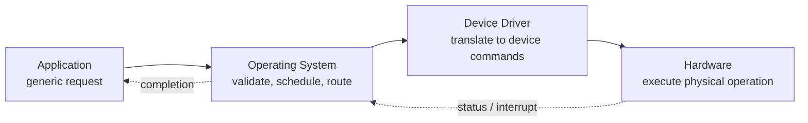
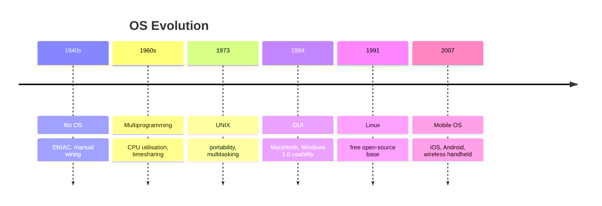
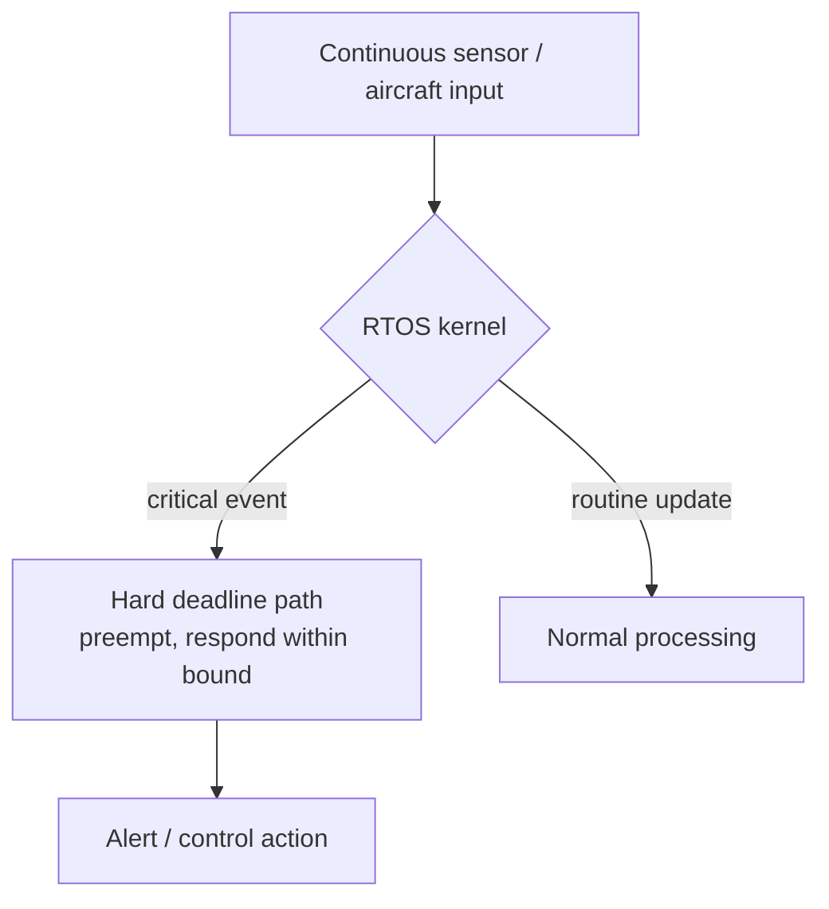

# BCL1213 / BTL1213 / BIT1213 Operating Systems
## Tutorial 1: Introduction to Operating System — Answers

| Field | Detail |
|---|---|
| Course | BCL1213 / BTL1213 / BIT1213 Operating Systems |
| Name | Chan Jing Yi |
| Student ID | SUOL2500321 |
| Tutorial | Tutorial 1 — Introduction to Operating System |
| Date | 11 October 2026 |

---

## Question 1 — Define an Operating System and explain why it is considered a resource manager

An Operating System (OS) is a program that allows a user to interact with computer hardware. It forms the comprehensive platform that identifies, configures and manages processors, memory devices and memory management, chipsets, storage, networking, port communication interfaces and subsystem interfaces.

The description of the OS as a resource manager reflects its central allocation role. Hardware resources — CPU time, main memory, disk space, printers, network interfaces — are finite, while demands from users and applications are concurrent and potentially conflicting. The OS therefore handles file management, task management, memory management, process management, disk management, I/O management and peripherals management. Without this arbitration, one faulty or greedy program could monopolise the processor, overwrite another program's memory, or leave a printer in an unusable state. By tracking ownership, enforcing protection boundaries, queuing requests and reclaiming resources on termination, the OS converts raw, contention-prone hardware into an orderly, shared service.

## Question 2 — Relationship: Application → Operating System → Device Driver → Hardware

Applications never touch hardware directly in a modern system. The chain represents a controlled layer of indirection. An application issues a standardised, hardware-independent request. The OS receives that call, validates permissions and scheduling policy, then selects the corresponding device driver from its large library of drivers to tailor the service to the specific hardware environment. The driver translates the generic call into the exact register commands, control signals and timing sequences the underlying device requires, then returns status back up the chain.

A print request illustrates the flow. Microsoft Word calls a generic print function with no knowledge of the printer model. The OS spooler accepts the job, checks that the user may use the printer, and queues it if the device is busy. The printer driver converts pages into Printer Command Language or bitmap raster data understood by that model. The printer hardware then actuates paper feed, toner and fuser. A storage write behaves identically: the application makes a common call to save a file, the OS resolves the path, permissions and free blocks through the file system, and the disk driver emits SATA or NVMe commands to the controller.

The value of this separation is portability and protection. Application writers target one stable API, hardware vendors supply only the driver, and the OS retains authority to deny, delay or interleave access.

## Question 3 — Three essential capabilities provided to users

From an end-user perspective the OS delivers three capabilities: a user interface, application execution, and hardware resource allocation, typically exposed through a standardised Application Programming Interface.

The user interface offers a controlled means of issuing commands and observing state, either through a Command Line Interface or a Graphical User Interface. A student who double-clicks a PDF icon in Windows Explorer or types `ls` in a Linux terminal is using this capability; the OS interprets the gesture, locates the program and presents windows, menus and error messages.

Application execution covers launching programs and managing their lifetime. When the user opens a browser, the OS loader places the code in memory, creates a process with its own address space, schedules its threads on the CPU, handles its system calls, and terminates and reclaims its resources on exit. The user perceives a simple launch, while process creation, context switching and exception handling occur beneath.

Hardware resource allocation determines which application receives which device and for how long. If two programs request the shared department printer and the backup disk drive simultaneously, the OS queues print jobs, assigns drive letters or mount points, and arbitrates access so neither job corrupts the other. A practical case is plugging in a USB drive: the OS detects the device, loads the driver, mounts the file system and grants read and write handles to authorised applications.

## Question 4 — OS as resource manager: Chrome and Word running simultaneously

When Google Chrome demands memory and CPU time while Microsoft Word demands memory and storage access, the OS performs concurrent multiplexing across three dimensions.

For the processor, the scheduler grants each runnable thread a short quantum in round-robin fashion, saving and restoring registers at each context switch so both programs progress without either starving the other. Chrome's rendering thread and Word's autosave thread are interleaved on the same core or spread across cores according to priority and affinity.

For memory, the memory manager partitions physical RAM into per-process virtual address spaces. Each application receives the illusion of contiguous private memory, backed by paging to disk when physical frames run short. Protection bits prevent Chrome's tab processes from overwriting Word's document buffer, and the OS reclaims pages when a tab or document closes.

For storage, the I/O subsystem serialises Word's file reads and writes through the file system and disk driver, queuing them fairly alongside Chrome's cache activity. Device independence means Word issues the same save call regardless of whether the target is an SSD, HDD or network share; the OS and driver resolve the difference. The outcome is isolation with sharing: both applications run as if each owned the machine, while the OS enforces limits, resolves contention and preserves data integrity.

## Question 5 — Chronological order and how each development met changing requirements

Correct approximately chronological order:

1. Early computers without OS — 1940s–1950s
2. Multiprogramming — 1960s
3. UNIX — 1973
4. Graphical User Interface — 1984–1985
5. Linux — 1991
6. Mobile OS — 2007–2008

Early machines such as the U.S. government's ENIAC were wired through thousands of connectors and mercury-delay-line memory, with no supervisory program. Every job required manual setup by operators, so utilisation was poor and only specialists could use the machine. The requirement at this stage was simply to make expensive hardware usable without rewiring for each task.

Multiprogramming, introduced with systems such as CTSS (1961) and Multics (1969), kept several jobs resident in memory so the CPU could switch to another job during I/O waits. This directly attacked idle-processor waste and allowed a single system to serve interactive users through timesharing rather than one batch job at a time.

UNIX, released by Bell Labs in 1973, answered the fragmentation created by machine-specific systems. Written for portability and offering simplicity with multitasking, it could work on different systems instead of being tied to one vendor's hardware. TCP/IP support in UNIX later made networking an expected OS service rather than an add-on.

The Graphical User Interface, popularised by the Apple Macintosh (1984) and Microsoft Windows 1.0 (1985), addressed usability. Command-line operation excluded non-technical users; windows, icons and a mouse lowered the skill threshold and widened personal computing.

Linux (1991) responded to cost and openness demands. As a free and open-source development, it gave universities, firms and later cloud providers a modifiable UNIX-like base without licence lock-in, which proved decisive for servers, embedded devices and virtualisation hosts.

Mobile OSs — iOS (2007) and Android (2008) — adapted the OS to small, battery-powered, always-connected handhelds. Beyond personal-computer functions they manage touch input, sensors, power states and wireless connectivity, reflecting a shift from desk-bound computation to mobility and cloud services.

## Question 6 — Why multiprogramming mattered: the problem it addressed

The importance of multiprogramming lies in the mismatch between processor speed and electromechanical I/O speed. A job that reads cards, waits for tape, or pauses for operator input leaves a fast CPU idle for orders of magnitude longer than it computes. In a single-program system that idle interval is pure waste on hardware that was extraordinarily expensive to purchase and operate.

Multiprogramming retained several jobs in memory at once so that when the running job blocked on I/O, the OS could dispatch another ready job to the idle processor. Utilisation rose without requiring a faster processor, throughput improved because I/O and computation overlapped, and the same hardware could support timesharing among multiple interactive users. The innovation was therefore economic and architectural rather than terminological: it transformed the OS from a simple loader into a scheduler that continuously arbitrates the CPU between competing jobs, a principle that underlies every modern multitasking system.

## Question 7 — Why UNIX portability was valuable

Portability means the same operating system can work on different hardware systems with limited rewriting, a property UNIX achieved by high-level-language implementation and a clean separation between machine-dependent and machine-independent parts.

The value is threefold. Hardware independence frees users from vendor lock-in; an organisation can migrate from one minicomputer or microprocessor to another while retaining tools, scripts and staff expertise. Development economy follows: one codebase serves many platforms, so bug fixes, security patches and new utilities propagate everywhere instead of being reimplemented per machine. Ecosystem growth is the third effect. Because UNIX ran widely, the TCP/IP stack, the C toolchain and later portable utilities diffused with it, establishing de facto standards that lowered integration cost across the industry. In a period when CP/M, PC-DOS and proprietary systems fragmented the market, an OS that travelled across machines reduced both procurement risk and software maintenance burden.

## Question 8 — Why a designer would keep the kernel smaller (microkernel)

A microkernel retains only major functions — process and memory management — in privileged kernel space, relocating file management and I/O management to user-space servers, as seen in MINIX and QNX. This contrasts with a monolithic design such as Linux or UNIX, where all functionalities reside in one kernel module, and with hybrid designs such as Windows NT and macOS X that blend the two.

The motive is structural discipline. Modularity improves because each service becomes a bounded component with an explicit message-passing interface; a file-system revision can be rebuilt and restarted without recompiling the entire kernel. Stability follows from fault isolation. A defect in a user-space driver or file server crashes that server rather than halting the whole machine, and the microkernel can restart it — a decisive property for telecommunication or automotive controllers. System organisation also simplifies verification and porting: the trusted computing base shrinks, so auditing, formal analysis and adaptation to new processors concentrate on a small core. The price is additional inter-process communication overhead, which hybrid architectures attempt to balance, yet where reliability and maintainability outweigh raw call latency the smaller kernel is the deliberate choice.

## Question 9 — Airport air-traffic monitoring scenario

### a. Most appropriate OS type

A Real-time OS (RTOS) is the appropriate choice. Batch, time-sharing and network OSs optimise for throughput, fairness or sharing, but none guarantees bounded response. The scenario centres on continuous sensor input with a strict and predictable time requirement upon critical events — the textbook definition of a real-time system, alongside missile systems, robotics and air-traffic control cited in the lecture.

### b. Hard RTOS or Soft RTOS

A Hard RTOS should be selected. In a hard real-time system the deadline is strict: a late response counts as failure, regardless of average speed. Missed separation alerts in air-traffic monitoring risk loss of life and regulatory breach. A Soft RTOS tolerates occasional deadline misses with degraded quality, suitable for video streaming where a dropped frame is noticeable but not catastrophic. Because the cost of missing a critical aircraft alert is unacceptable, determinism must be guaranteed by design through priority-based preemptive scheduling, bounded interrupt latency and schedulability analysis — not treated as a best effort.

### c. Why a batch OS is unsuitable

A Batch OS does not interact with the computer directly. An operator groups similar jobs with the same requirements into batches for efficient bulk processing, with no per-event interaction. Turnaround is measured in minutes or hours, ordering follows the batch queue rather than external urgency, and there is no mechanism to preempt a running batch when a critical sensor reading arrives. Continuous monitoring demands event-driven, interrupt-responsive behaviour; batch design provides the opposite.

### d. Why fast processing alone is insufficient

Speed describes average throughput, while the requirement is determinism. A fast time-sharing server may usually respond in milliseconds yet occasionally delay a task for hundreds of milliseconds under load, because quantum expiry, paging or a long critical section introduces jitter. Real-time correctness depends on the worst-case response time remaining within the stated bound on every invocation, under full load. Predictability therefore requires bounded latency, priority inheritance, and proof that deadlines hold — properties a merely fast processor without RTOS scheduling discipline cannot assure.

## Question 10 — Have modern operating systems become more complex because computers have become more complex?

Agreement with the statement is warranted, with one qualification: complexity has grown on both sides and each side has driven the other.

Hardware scope has widened markedly. The OS must identify, configure and manage multicore processors, tiered memory, diverse chipsets, storage hierarchies from NVMe to cloud buckets, networking stacks, port interfaces and subsystem controllers — far beyond the single processor and card reader of early systems. To this have been added virtual-machine architectures that multiplex several operating systems on one physical machine, layered organisations that separate hardware, kernel, system-call and shell concerns, and mobile power, sensor and radio management for handheld devices.

Each hardware advance demanded a corresponding OS service: multiprogramming to hide I/O latency, UNIX networking for TCP/IP, GUIs for mass usability, Linux-scale modularity for servers and embedded reuse, mobile frameworks for telephony and location, and current virtualisation and cloud orchestration for elastic data centres. Architecture choices directly affect performance, flexibility and security, so the kernel, schedulers, memory managers and I/O stacks accumulated policy to cover the new cases.

The qualification is that OS design choices also invited hardware complexity — virtualisation extensions, trusted execution modes and programmable I/O exist partly because operating systems needed them. Causation runs both ways. The statement nevertheless captures the dominant direction: as the machine diversified, the program charged with managing it had to diversify in step.

---

## References

Silberschatz, A., Galvin, P. B. and Gagne, G. (2021) *Operating System Concepts*. 10th edn. Hoboken: Wiley.

Stallings, W. (2018) *Operating Systems: Internals and Design Principles*. 9th edn. Harlow: Pearson.

Tanenbaum, A. S. and Bos, H. (2015) *Modern Operating Systems*. 4th edn. Harlow: Pearson.
