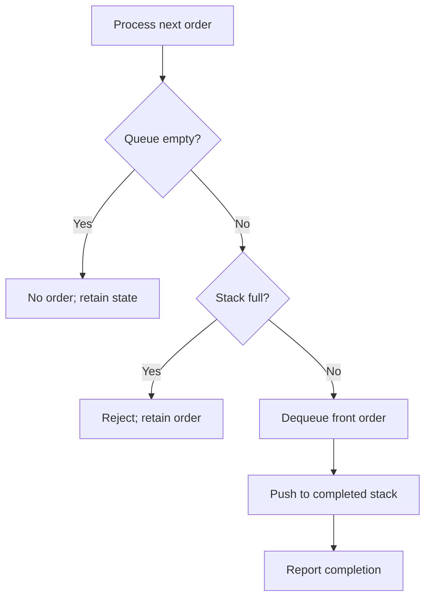
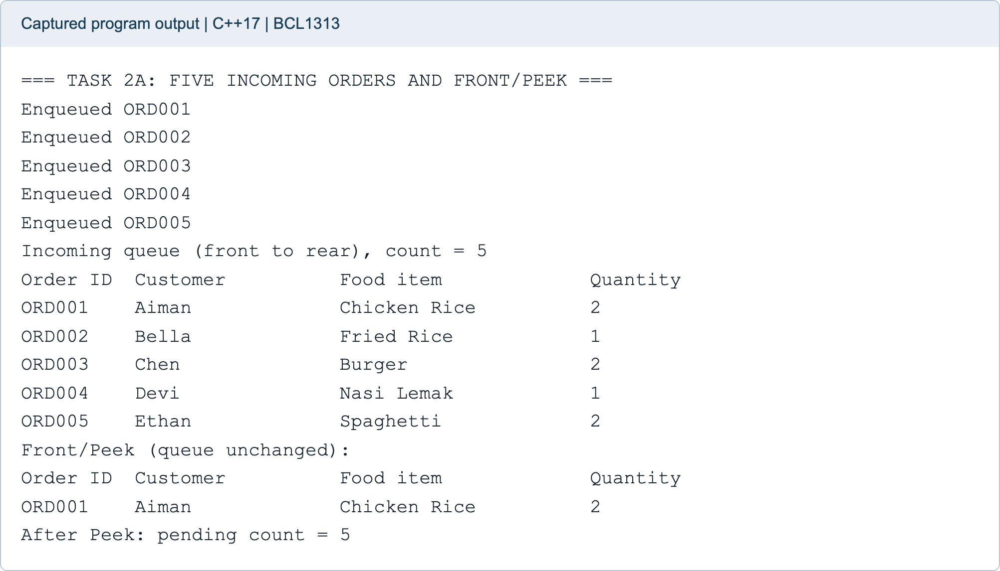
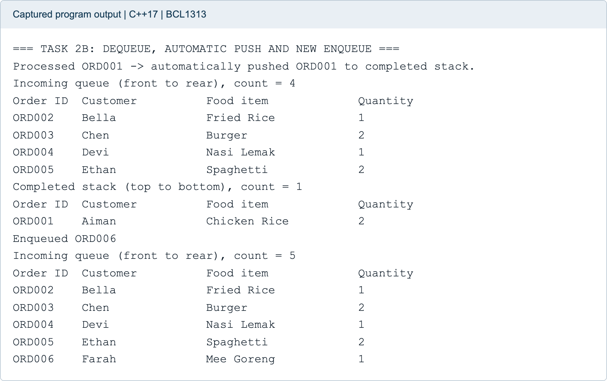
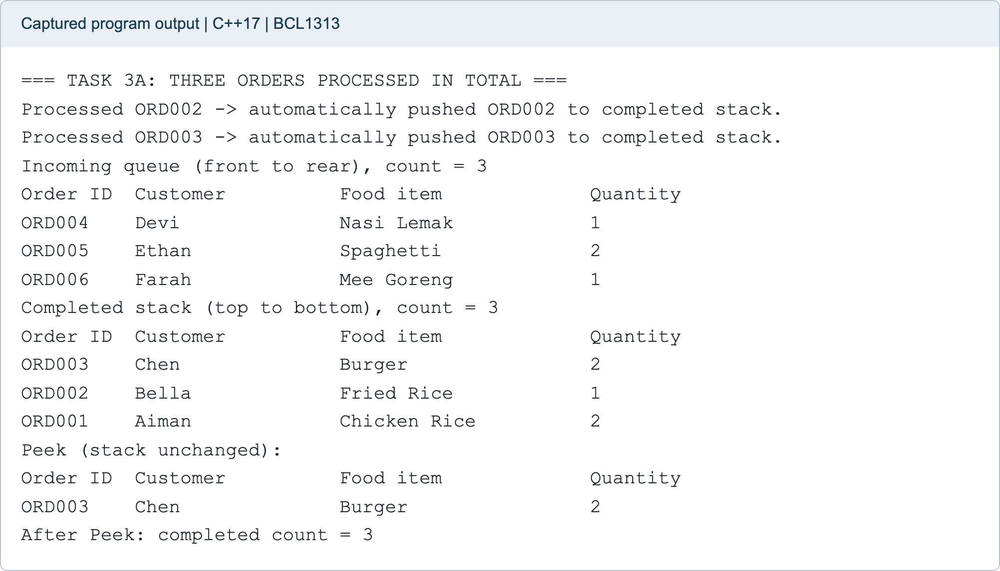
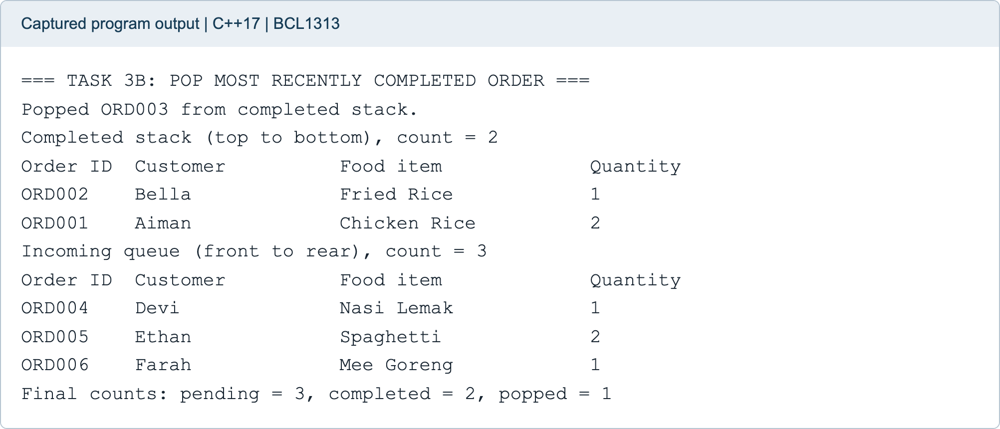
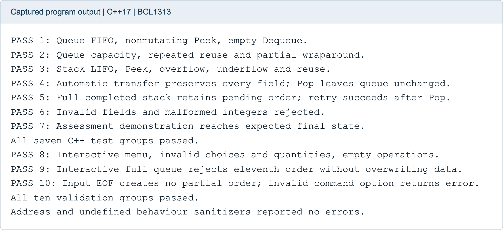

# Restaurant Order Management System
## Lab Assessment 1: Stack and Queue Implementation

**BCL1313: Algorithms and Complexity**

Bachelor of Computer Science  
SEGi University, Kota Damansara

**Student name:** Chan Jing Yi  
**Student ID:** SUOL2500321  
**Assessment:** Individual lab assessment, 20%  
**Submission date:** 15 November 2026  
**Implementation language:** C++17

This report presents the design, implementation and testing of a restaurant order management system. A circular queue manages incoming orders in arrival order, while an array stack stores completed orders in reverse completion order.

<!-- page -->

# 1. Purpose, principles and sample orders

The system represents the movement of customer orders from a waiting list to a completed collection. Processing an order is modelled as removing the earliest waiting order and immediately recording it as completed. The assessment focuses on data structure behaviour rather than kitchen preparation times, payment processing or persistent storage.

A queue follows the first in, first out principle, abbreviated FIFO. An item enters at the rear and is removed from the front (Black, 2020). This allows the restaurant to process the earliest received order before later arrivals. A stack follows the last in, first out principle, abbreviated LIFO, making the most recently inserted item the next item removed (Black, 2019). The completed collection therefore exposes the latest completed order at its top.

## 1.1 Customer order dataset

Each order contains an identifier, customer name, food item and positive integer quantity. The first five records reproduce the assessment example. Farah's order provides the additional arrival required after the initial Dequeue operation.

| Order ID | Customer name | Food item | Quantity |
| :--- | :--- | :--- | ---: |
| ORD001 | Aiman | Chicken Rice | 2 |
| ORD002 | Bella | Fried Rice | 1 |
| ORD003 | Chen | Burger | 2 |
| ORD004 | Devi | Nasi Lemak | 1 |
| ORD005 | Ethan | Spaghetti | 2 |
| ORD006 | Farah | Mee Goreng | 1 |

*Table 1. Sample customer orders used during the demonstration.*

## 1.2 Structure selection

Both structures are implemented directly using arrays of ten order records. The queue uses circular indexing, a bounded array representation consistent with the circular queue definition in Black (2004). The stack stores its top at the highest occupied array index. These representations expose the underlying operations without relying on the standard library queue or stack adaptors. Ten records provide a clear capacity boundary for testing; the constant can be increased for a larger demonstration.

<!-- page -->

# 2. Queue and stack implementation

## 2.1 Circular queue

The queue maintains `frontIndex` and `count`. Its invariant is that `count` remains between zero and the capacity. Logical item `i` occupies `(frontIndex + i) % CAPACITY`; the next insertion position is `(frontIndex + count) % CAPACITY`.

```cpp
bool enqueue(const Order& order) {
    if (full()) return false;
    items[(frontIndex + count) % CAPACITY] = order;
    ++count;
    return true;
}

bool dequeue(Order& removed) {
    if (empty()) return false;
    removed = items[frontIndex];
    items[frontIndex] = Order{};
    frontIndex = (frontIndex + 1) % CAPACITY;
    --count;
    return true;
}
```

Modulo arithmetic reuses freed slots without shifting the remaining records. Front/Peek returns a pointer to the front record or a null pointer for an empty queue. It changes neither the count nor the front index. Display traverses the logical queue order, which remains correct when the occupied records cross the array boundary.

## 2.2 Array stack

The stack also maintains a count. Push writes to `items[count]` and increments the count, provided space remains. Pop copies `items[count - 1]` to the output record, clears that slot and decrements the count. Peek returns the same top record without modifying it. Display traverses indices from `count - 1` down to zero, making the top appear first.

Empty Pop and Dequeue return failure before accessing an array element. Full Push and Enqueue return failure before writing. The use of `std::array`, meaningful member names and separate classes keeps storage ownership explicit and separates queue behaviour from stack behaviour.

<!-- page -->

# 3. Integration and user interaction

## 3.1 Processing an order



*Figure 1. Processing flow and capacity protection.*

`RestaurantSystem::processOrder` coordinates both structures. It checks that an incoming order exists and that the completed stack has space. Only then does it call Dequeue followed immediately by Push. The transferred record retains its identifier, customer, food item and quantity. In this single threaded program, the stack cannot become full between the check and the Push through another user action.

Checking the destination first prevents a capacity failure from discarding a waiting order. A failed processing request preserves both collections. Pop removes a completed record from the history only; it does not return the order to the incoming queue or undo food preparation.

## 3.2 Interactive operation and validation

The menu provides Enqueue, processing through Dequeue and Push, incoming Front/Peek, incoming Display, completed Peek, completed Pop and completed Display. A separate demonstration mode executes the prescribed assessment sequence consistently.

Interactive entry generates sequential identifiers for successfully accepted orders. Customer and food text must contain nonblank content, with limits of 16 and 20 characters respectively. Quantity must be a whole number from 1 to 999. Full line parsing rejects malformed values such as `2abc` and `1.5`; invalid choices prompt the user again. End of input during an unfinished order does not add a partial record.

<!-- page -->

# 4. Queue demonstration: initial state and Peek

Five orders are enqueued in sequence from ORD001 to ORD005. Display prints them from front to rear, placing Aiman first and Ethan last. Front/Peek identifies ORD001, including the original customer, food item and quantity.



*Figure 2. Captured executable output showing five insertions, queue Display and Front/Peek.*

The pending count remains five after Peek. Aiman's record stays at the front, demonstrating that inspection does not remove an order. This result establishes the starting FIFO order before processing begins.

<!-- page -->

# 5. Queue demonstration: processing and new arrival

Processing removes ORD001 from the front and automatically pushes it onto the completed stack. The updated queue contains ORD002, ORD003, ORD004 and ORD005. Farah's new order, ORD006, is then enqueued at the rear.



*Figure 3. Captured executable output showing the updated queue, automatic Push and additional arrival.*

The front remains ORD002 after Farah's arrival, while ORD006 appears after ORD005. The new order therefore cannot overtake orders already waiting. The completed stack contains ORD001 immediately after the first processing request, confirming that transfer needs no separate manual Push action.

<!-- page -->

# 6. Stack demonstration: automatic Push and Peek

Two more processing requests remove ORD002 and ORD003, bringing the total number processed to three. Each request automatically pushes its order onto the completed stack. The waiting queue now contains ORD004, ORD005 and ORD006.



*Figure 4. Captured executable output showing three completed orders and stack Peek.*

Display lists ORD003, ORD002 and ORD001 from top to bottom. Chen's order is on top because it completed most recently. Stack Peek returns ORD003 and leaves the completed count at three. The queue preserves arrival order while the stack reverses completion order, directly distinguishing FIFO from LIFO.

<!-- page -->

# 7. Stack demonstration: Pop and final state

Pop removes ORD003, the most recently completed order. The updated stack contains ORD002 above ORD001. The incoming queue remains ORD004, ORD005 and ORD006 because Pop affects completed history only.



*Figure 5. Captured executable output showing Pop, updated Display and final counts.*

| Stage | Queue from front to rear | Stack from top to bottom |
| :--- | :--- | :--- |
| Initial five arrivals | 001, 002, 003, 004, 005 | Empty |
| First order processed | 002, 003, 004, 005 | 001 |
| Sixth order arrives | 002, 003, 004, 005, 006 | 001 |
| Three orders processed | 004, 005, 006 | 003, 002, 001 |
| Most recent completion popped | 004, 005, 006 | 002, 001 |

*Table 2. State trace; numeric suffixes represent ORD identifiers.*

The final counts reconcile all six arrivals: three pending, two retained completions and one popped completion. No order is missing from this demonstration accounting.

<!-- page -->

# 8. Complexity analysis and limitations

Let `n` be the number of pending orders, `m` the number of retained completed orders and `C` the capacity of each array. The following bounds count record operations and treat order text lengths as bounded. The public console enforces short fields; when arbitrary unbounded strings are passed directly to the classes, copying and printing also depend on their lengths.

| Operation | Worst case time | Reason |
| :--- | :--- | :--- |
| Queue Enqueue | O(1) | One array write, modulo calculation and count update |
| Queue Dequeue | O(1) | One record removal and front index update |
| Queue Front/Peek | O(1) | Direct access to the front index |
| Queue Display | O(n) | Every pending record is printed once |
| Stack Push | O(1) | One array write and count update |
| Stack Pop | O(1) | Direct top access and count update |
| Stack Peek | O(1) | Direct access to index `count - 1` |
| Stack Display | O(m) | Every completed record is printed once |
| Process next order | O(1) | Capacity checks, one Dequeue and one Push |
| Empty, full and size checks | O(1) | One count comparison or retrieval |

*Table 3. Bounds derived from the implemented loops and index operations.*

Enqueue and Dequeue have no loop over the waiting collection. A queue that shifted all remaining records after removal would take O(n) time for that removal. Circular indexing avoids this cost. Stack Push and Pop similarly change a single end position. Display necessarily takes linear time because all live records must be visited.

Each array reserves `C` record slots, so total allocated collection storage is O(C) for the two arrays, or O(1) when the configured capacity of ten is treated as fixed. The processing operation uses O(1) auxiliary record storage. For unbounded text fields, total string storage must also be counted.

The bounded design can reject incoming orders and block processing when completed history is full. Removing a completed record frees space, but it also discards that history. A production restaurant would require persistent records, larger or dynamic collections and policies for capacity, concurrent users and priority orders. The present system stores data in memory and resets on exit. It deliberately models each processing request as an immediate completion.

<!-- page -->

# 9. Verification results

Verification combines direct structure tests with execution through the actual interactive menu. Both the program and C++ tests compile with strict warning checks. Address and undefined behaviour sanitizers report no errors in the exercised paths. These checks support the observed results without proving correctness for every possible input.



*Figure 6. Actual validation results from the C++ tests and menu execution checks.*

| Case | Expected result | Observed result |
| :--- | :--- | :--- |
| Repeated Front/Peek | No count or order change | Passed |
| Queue full at ten records | Eleventh arrival rejected | Passed |
| Partial drain and refill | Freed slots reused; FIFO preserved | Passed |
| Empty Dequeue and Pop | Safe failure without array access | Passed |
| Stack full at ten records | Additional Push rejected | Passed |
| Processing with full stack | Pending order retained; retry after Pop succeeds | Passed |
| Automatic transfer | All four order fields preserved | Passed |
| Invalid quantity or menu text | Rejected with another prompt | Passed |
| Input ends during entry | No partial order accepted | Passed |

*Table 4. Boundary, integration and input validation checks.*

<!-- page -->

# 10. Self reflection

## 10.1 What did you learn about Stack and Queue data structures?

I learned that stacks and queues can store the same order records while enforcing different access rules. Tracing the identifiers made FIFO and LIFO easier to distinguish. I also recognised that Peek must preserve both the record and the collection size.

## 10.2 Why is Queue suitable for managing incoming restaurant orders?

A queue serves orders in their arrival sequence. Adding Farah's order at the rear keeps Bella ahead of later customers. This provides a clear service rule when every order has equal priority.

## 10.3 Why is Stack suitable for maintaining completed restaurant orders?

A stack makes the latest completed order immediately accessible. Chen's order appears above Bella's and Aiman's because it was completed last. Pop removes this latest record without disturbing the waiting queue.

## 10.4 Which part was most challenging, and how was it resolved?

Coordinating removal and insertion requires care because a full destination could otherwise lose an order. Checking stack capacity before Dequeue prevents that failure. The boundary test confirms that the waiting order remains available until space is freed.

## 10.5 How can Stack and Queue be applied elsewhere?

Queues can manage printer jobs and customer service requests. Stacks can support undo histories and expression evaluation. Choosing between them depends on whether arrival order or the latest action should control access.

# References

Black, P. E. (2004). *Circular queue*. Dictionary of Algorithms and Data Structures. National Institute of Standards and Technology. https://xlinux.nist.gov/dads/HTML/circularQueue.html

Black, P. E. (2019). *Stack*. Dictionary of Algorithms and Data Structures. National Institute of Standards and Technology. https://xlinux.nist.gov/dads/HTML/stack.html

Black, P. E. (2020). *Queue*. Dictionary of Algorithms and Data Structures. National Institute of Standards and Technology. https://xlinux.nist.gov/dads/HTML/queue.html

