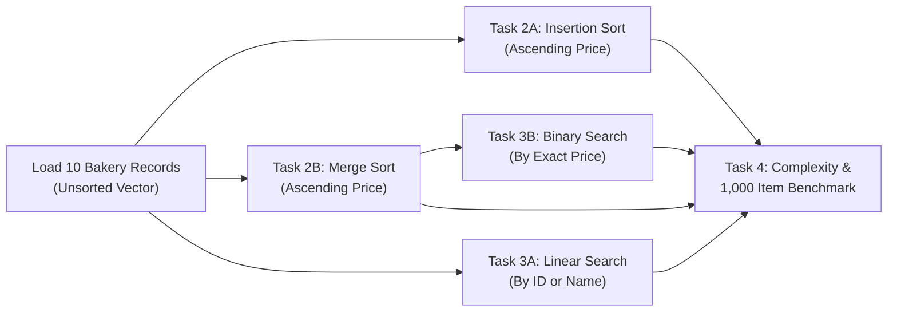
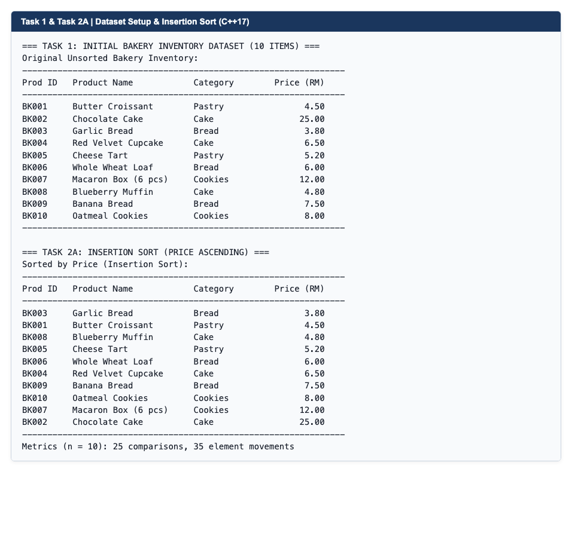
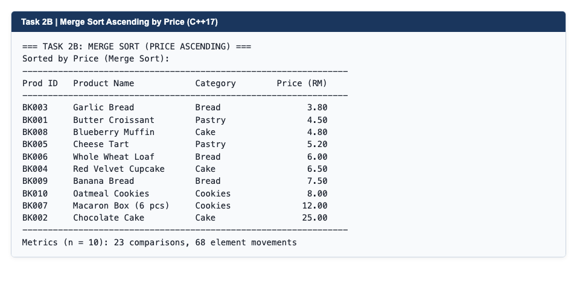
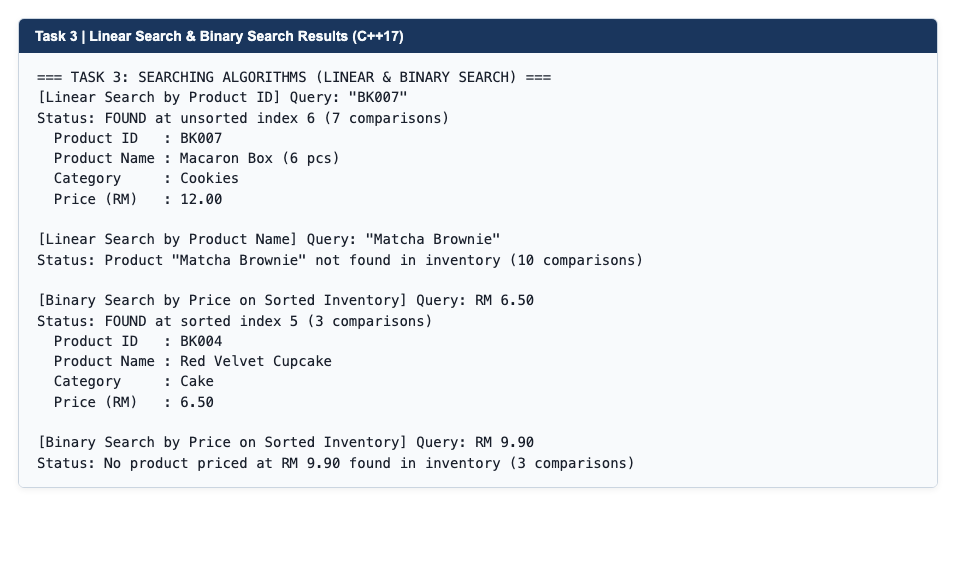
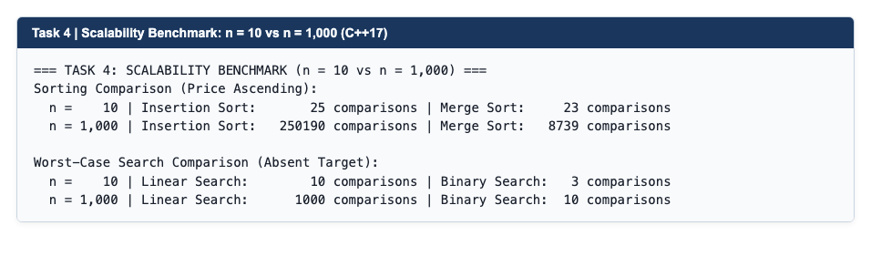

# Bakery Shop Inventory System: Sorting and Searching Analysis

Chan Jing Yi | SUOL2500321 | BCL1313 Algorithms and Complexity

## 1. System Overview and Dataset Design

Inventory software in retail environments depends on rapid ordering and retrieval of product records to support pricing updates, stock checks, and point of sale lookups. This implementation models a Bakery Shop Inventory System in C++17 using ten distinct product records. Each record is stored in a `Product` structure containing a unique product identifier (`id`), product name (`name`), category (`category`), and unit price in Malaysian Ringgit (`price`). All ten sample products from the bakery catalogue are loaded into a `std::vector<Product>` container so that independent copies can be passed to each sorting algorithm without mutating the original dataset.

| Product ID | Product Name | Category | Price (RM) |
| :--- | :--- | :--- | ---: |
| BK001 | Butter Croissant | Pastry | 4.50 |
| BK002 | Chocolate Cake | Cake | 25.00 |
| BK003 | Garlic Bread | Bread | 3.80 |
| BK004 | Red Velvet Cupcake | Cake | 6.50 |
| BK005 | Cheese Tart | Pastry | 5.20 |
| BK006 | Whole Wheat Loaf | Bread | 6.00 |
| BK007 | Macaron Box (6 pcs) | Cookies | 12.00 |
| BK008 | Blueberry Muffin | Cake | 4.80 |
| BK009 | Banana Bread | Bread | 7.50 |
| BK010 | Oatmeal Cookies | Cookies | 8.00 |

*Table 1. Initial unsorted bakery inventory dataset ($n = 10$).*

*Figure 1. Processing pipeline connecting dataset setup, sorting, searching, and empirical benchmarking.*

---

## 2. Sorting Algorithms Implementation (Task 2)

Two contrasting sorting algorithms were implemented to arrange the bakery records in ascending order of price: **Insertion Sort** and **Merge Sort**. Both algorithms preserve the relative order of products sharing identical prices, a property known as stability (Cormen et al., 2022). Each function returns a `SortMetrics` structure recording exact key comparisons and element movements so empirical behaviour can be verified directly against asymptotic theory.

### 2.1 Insertion Sort

Insertion Sort maintains a sorted prefix on the left side of the vector and inserts each subsequent element into its proper position by shifting larger priced items one slot to the right (Sedgewick and Wayne, 2011). Because the algorithm operates entirely inside the input vector using a single temporary `Product` key, its auxiliary space complexity is $O(1)$. On the ten item bakery inventory, Insertion Sort completed in 25 comparisons and 35 element movements, producing the ascending price sequence from Garlic Bread (RM 3.80) to Chocolate Cake (RM 25.00).

*Figure 2. Captured program output displaying the initial dataset and Insertion Sort results ($n = 10$).*

### 2.2 Merge Sort

Merge Sort applies a recursive divide and conquer strategy: it splits the active subarray at its midpoint until single element base cases are reached, then merges adjacent sorted halves using a preallocated auxiliary buffer (Cormen et al., 2022). Using `<=` during the merge comparison guarantees stability. Preallocating one reusable buffer of size $n$ avoids repeated dynamic allocations across recursive frames while maintaining $O(n)$ auxiliary space. On the ten item dataset, Merge Sort required 23 comparisons and 68 element movements, producing the exact same sorted sequence as Insertion Sort.

*Figure 3. Captured program output displaying Merge Sort ascending price results ($n = 10$).*

---

## 3. Searching Algorithms Implementation (Task 3)

Product lookup was implemented using **Linear Search** and **Binary Search**, with both routines returning a `SearchMetrics` record containing the matched index (or negative one when absent) and the exact number of key comparisons executed.

### 3.1 Linear Search

Linear Search scans the inventory sequentially from index zero until either a matching record is found or the end of the vector is reached (Weiss, 2014). Its primary practical advantage is that it requires no prior ordering, allowing staff to query unsorted records directly by product identifier or product name with case insensitive normalisation. Searching for `BK007` located Macaron Box (6 pcs) at unsorted index 6 in 7 comparisons. Searching for an absent product (`Matcha Brownie`) traversed all 10 records before reporting that the item was not found.

### 3.2 Binary Search

Binary Search operates on the price sorted vector produced by Merge Sort. At each iteration, it compares the target price against the middle element using a floating point tolerance (`1e-6`) and discards half of the remaining search interval (Knuth, 1998). Querying RM 6.50 located `BK004` (Red Velvet Cupcake) at sorted index 5 in only 3 comparisons. Querying an absent price of RM 9.90 exhausted the search space and confirmed absence in 3 comparisons rather than scanning the entire list.

*Figure 4. Captured program output showing found and not found executions for Linear Search and Binary Search.*

---

## 4. Performance Comparison and Scalability Analysis (Task 4)

To evaluate how theoretical growth rates translate into actual operational workload, both sorting and searching pairs were benchmarked on the original 10 item inventory and on a deterministic synthetic inventory of 1,000 bakery products. Table 2 summarises the asymptotic complexity, implementation characteristics, and measured comparison counts across both scales.

| Algorithm | Best Time | Average Time | Worst Time | Auxiliary Space | Comparisons ($n = 10$) | Comparisons ($n = 1,000$) | Ease of Implementation |
| :--- | :---: | :---: | :---: | :---: | :---: | :---: | :--- |
| **Insertion Sort** | $O(n)$ | $O(n^2)$ | $O(n^2)$ | $O(1)$ | 25 | 250,190 | Very high; short iterative loops with no recursion. |
| **Merge Sort** | $O(n \log n)$ | $O(n \log n)$ | $O(n \log n)$ | $O(n)$ | 23 | 8,739 | Moderate; requires recursive partitioning and merge buffer. |
| **Linear Search** | $O(1)$ | $O(n)$ | $O(n)$ | $O(1)$ | 10 (absent) | 1,000 (absent) | Very high; single sequential scan on any order. |
| **Binary Search** | $O(1)$ | $O(\log n)$ | $O(\log n)$ | $O(1)$ | 3 (absent) | 10 (absent) | Moderate; requires sorted input and careful bound updates. |

*Table 2. Theoretical complexity and empirical comparison counts across small ($n = 10$) and expanded ($n = 1,000$) inventories.*

*Figure 5. Captured program output comparing operation counts at $n = 10$ and $n = 1,000$.*

At $n = 10$, the difference between Insertion Sort and Merge Sort is negligible: Insertion Sort performs two more comparisons (25 versus 23) yet executes fewer element movements (35 versus 68) because it avoids copying records into and back from a temporary buffer. On tiny or nearly sorted lists, Insertion Sort can therefore outperform recursive divide and conquer methods due to lower constant overhead and superior cache locality (Sedgewick and Wayne, 2011).

Once the catalogue expands to 1,000 items, quadratic growth dominates. Insertion Sort escalates from 25 to 250,190 comparisons, closely tracking the expected $n^2 / 4 \approx 250,000$ average case, whereas Merge Sort requires only 8,739 comparisons, a 28.6 fold reduction. A similar divergence appears in searching: worst case Linear Search grows linearly to 1,000 comparisons, while Binary Search requires at most $\lceil \log_2(1000) \rceil = 10$ comparisons, achieving a 100 fold reduction. For large datasets, **Merge Sort** paired with **Binary Search** is substantially more suitable because logarithmic and linearithmic scaling prevent latency spikes as product catalogues grow, provided the inventory is read more frequently than it is reordered (Cormen et al., 2022).

---

## 5. Self Reflection

I selected Insertion Sort and Merge Sort for sorting, paired with Linear Search and Binary Search for retrieval, to contrast simple baseline algorithms against scalable divide and conquer methods. Insertion Sort builds a sorted prefix iteratively in quadratic $O(n^2)$ average time with $O(1)$ space, whereas Merge Sort recursively splits and merges subarrays in guaranteed $O(n \log n)$ time using $O(n)$ auxiliary memory. Similarly, Linear Search inspects unsorted records sequentially in $O(n)$ time, while Binary Search halves a sorted range in $O(\log n)$ time.

The main implementation challenges involved preserving sort stability when merging equal prices, preventing floating point precision errors during Binary Search price comparisons, and isolating clean metric counters without distorting algorithm logic. If the bakery expands to 1,000 products, I would choose Merge Sort and Binary Search. My benchmark confirmed that Merge Sort cuts comparisons from 250,190 to 8,739, while Binary Search reduces worst case lookups from 1,000 to 10. In commercial inventory operations, algorithmic efficiency directly governs checkout responsiveness, stock replenishment speed, and server scalability, preventing operational bottlenecks during peak customer demand.

---

## References

Cormen, T.H., Leiserson, C.E., Rivest, R.L. and Stein, C. (2022) *Introduction to Algorithms*. 4th edn. Cambridge, MA: MIT Press.

Knuth, D.E. (1998) *The Art of Computer Programming, Volume 3: Sorting and Searching*. 2nd edn. Reading, MA: Addison Wesley.

Sedgewick, R. and Wayne, K. (2011) *Algorithms*. 4th edn. Boston, MA: Addison Wesley.

Weiss, M.A. (2014) *Data Structures and Algorithm Analysis in C++*. 4th edn. Boston, MA: Pearson.
