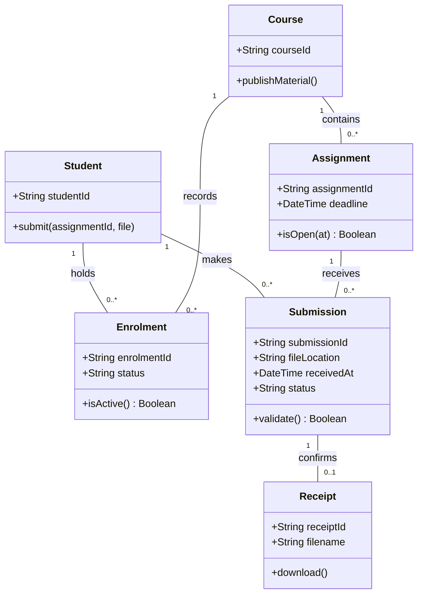

<!-- page: 1 -->
# 1. Planning and analysis
## 1.1 Proposed system and evidence
The proposed University LMS improves course delivery for a mid sized private university, using SEGi’s Camu experience as its case context. Its scope covers enrolment, materials, assignments, grades and course communication. Attendance and finance remain outside the initial release.

A public MyCamu review reports unsuccessful downloads and unexpected logout (Kiruba, 2026). An older review reports submission and timetable notification difficulties (Suriyakumar, 2021). These individual accounts identify concerns, but cannot establish their frequency or current occurrence at SEGi. Conversely, university guidance documents assignment deadlines and completion status within MyCamu (Punay, 2026). The proposal therefore improves discoverability and verification without assuming these capabilities are absent.

## 1.2 Objectives
Objective one is to provide enrolled students with a unified deadline dashboard and consistent course workspace before the next academic year. Objective two is to make assignment submission verifiable and protect academic information through receipts, permissions and tested recovery procedures. Proposed acceptance targets appear in the specification.

# 2. Requirements engineering
## 2.1 Elicitation and evidence status
The supplied project summary identifies navigation, confirmation, session and accessibility concerns. Its original respondents, dates and sources are unspecified; it is preliminary scoping input. Public reviews provide secondary evidence, not direct elicitation from SEGi users. No interview responses, participant counts or survey percentages are invented.

The proposed elicitation combines interviews with students, lecturers and an administrator, followed by a survey. Interviews explore failed tasks and exceptions; the survey checks priorities across respondents. Appendix A contains questions and recording instructions. Direct responses and stakeholder validation remain necessary to satisfy the brief’s real user requirement. Evidence should be anonymised and retained only as needed for the assignment, with participants informed about how their responses will be used.

Interview participants should demonstrate how they locate a deadline, retrieve materials and confirm a submission. Ask neutral follow up questions about the device, connection and sequence of actions. Separate software failures from missing lecturer content or institutional settings. Compare responses by role and invite participants to correct the interpretation. The survey should ask about frequency and importance separately, because an infrequent failure may still have severe consequences.

<!-- page: 2 -->
## 2.2 Functional user requirements
Students access enrolled courses; lecturers manage assigned courses; administrators manage membership and staff assignments. All requirements are provisional until users validate them.

Table 1. Functional requirements and acceptance conditions

| ID | Required system behaviour |
| :--- | :--- |
| FR1 | Allow an authenticated student to enrol in an open course. Reject duplicate membership and show confirmation. |
| FR2 | Let assigned lecturers publish materials in a standard course area. Only enrolled students and authorised staff can download them. |
| FR3 | Accept a student’s PDF or DOCX assignment up to 20 MB. Issue a unique receipt only after successful storage and record creation. |
| FR4 | Let lecturers create assignments and publish deadlines, grades and feedback. Students see only their own private results. |
| FR5 | Provide course announcements and messages to enrolled students and assigned lecturers, with a visible delivery status. |
| FR6 | Display published deadlines across enrolled courses chronologically and export them as a calendar file. |
| FR7 | Let students reopen receipts showing filename and server receipt time, and download the exact stored submission. |
| FR8 | Let administrators create courses and assign lecturers and memberships. Reject unauthorised administrative requests. |

## 2.3 Analysis and traceability
Navigation concerns motivate FR2 and FR6; submission uncertainty motivates FR3 and FR7. Communication and assessment requirements also follow the assignment scenario. This mapping supports prioritisation without presenting assumptions as measured findings. Receipts and permission controls take priority over calendar export because submission loss has greater academic consequences.

The evidence also requires critical appraisal. Public reviewers select themselves and may use different configurations, versions and institutions. The 2021 review is historical evidence, so it supports investigation rather than a claim about current behaviour. Missing information about email receipts or mobile accessibility cannot establish that those features are universally absent. A local observation log should record the date, device, task and outcome, then distinguish reproduced problems from unresolved reports.

<!-- page: 3 -->
## 2.4 Nonfunctional requirements
The following values are proposed acceptance targets, not observed Camu performance. Validate the workload and service commitments with university stakeholders.

Table 2. Nonfunctional requirements and verification

| ID | Measurable requirement |
| :--- | :--- |
| NFR1 | Deny every tested attempt to read another student’s private submission or grade without an authorised staff role. |
| NFR2 | Under 500 active simulated sessions, complete 95% of course page requests within three seconds, excluding file transfer. |
| NFR3 | Achieve 99.5% monthly availability excluding announced maintenance, measured by external monitoring. |
| NFR4 | Restore encrypted daily backups within four hours, losing at most 24 hours of records, demonstrated in a recovery exercise. |
| NFR5 | Meet WCAG 2.2 AA across assessed student journeys, verified through automated checks and manual keyboard and screen reader testing. |
| NFR6 | Reject disallowed, oversized or malicious files before release. Validate content and permissions and store uploads outside public executable paths. |

## 2.5 Requirements validation and control
Elicitation is followed by analysis, specification, validation and controlled revision. Replace vague statements such as “fast uploads” with measurable conditions. Check contradictions through shared definitions: a deadline uses server time, a submission completes when storage and metadata succeed, and late work requires an authorised extension. Failed transfers produce no success receipt.

Each requirement links to its source, owner and acceptance test. Stakeholders review exception scenarios before approval; versioned change requests document effects on cost, tests and schedule. Accessibility follows W3C (2024), while upload controls follow OWASP (n.d.). Neither guidance replaces local user validation.

For mobile sessions, preserve draft form content before expiry, warn users before requiring authentication and restore the draft afterwards. Do not extend access indefinitely or bypass permission checks. Confirm the university’s preferred timeout policy with administrators. Test interruptions by switching applications and reconnecting after network loss; the expected behaviour must distinguish a saved draft from an accepted assignment.

<!-- page: 4 -->
# 3. Scrum process model
## 3.1 Implementation and suitability
Scrum provides short feedback cycles for uncertain requirements (Schwaber and Sutherland, 2020). The Product Owner orders the Product Backlog around a reliable course workspace. Two week Sprints produce usable increments, beginning with enrolment and progressing through materials, submissions and grading.

Sprint Planning establishes a Sprint Goal and selected work; developers adapt their plan during the Daily Scrum. In a submission Sprint, validation, storage and receipts form one usable slice. At the Sprint Review, students and lecturers inspect it and influence backlog priorities. The Retrospective improves working practices, such as preventing repeated upload defects.

The Definition of Done requires reviewed code, passing acceptance tests, accessibility checks and updated documentation. Scrum suits the LMS because feedback can reveal policy exceptions before release. It cannot guarantee a fixed scope and launch date; lower priority work must remain negotiable.

# 4. System design
## 4.1 Modelling approach
The following diagrams describe the proposed system, not Camu’s internal implementation. Figure 1 maps actors to all eight functional requirements. Figure 2 models assignment submission with attributes, operations and multiplicities. Authentication is a precondition; course membership and staff assignment determine authorisation.

<!-- page: 5 -->
## 4.2 Use case diagram

Figure 1. Proposed LMS use case diagram

Student associations cover enrolment, materials, submissions, communication, deadlines and receipts. Lecturers publish content, assess work and communicate. Administrators manage course access. Solid associations indicate participation rather than execution order. FR4 groups assignment management and assessment; permission checks distinguish lecturer actions from student result viewing.

<!-- page: 6 -->
## 4.3 Assignment submission class diagram

Figure 2. Assignment submission domain classes

Enrolment resolves student and course membership. Each submission belongs to one student and assignment. An unsuccessful submission has no receipt; an accepted submission must have exactly one. Enforcing submission identifier uniqueness prevents duplicate confirmation when a client retries. File storage and metadata must agree before acceptance, with recovery handling partial failures. These rules support FR3, FR7 and the integration tests.

<!-- page: 7 -->
# 5. Team roles and project planning
## 5.1 Responsibilities
The Product Owner sets priorities and accepts business outcomes. The Scrum Master facilitates events and removes impediments. Developers design, implement and integrate the LMS. A quality engineer develops tests and reports defects; a security and accessibility specialist reviews protection and inclusive interaction. Specialists contribute within the Scrum Developers accountability rather than forming a separate approval hierarchy.

## 5.2 Indicative delivery timeline

Table 3. Proposed lifecycle timeline

| Weeks | Delivery focus and milestone |
| :--- | :--- |
| 1 to 2 | Elicitation, policy clarification and initial backlog. |
| 3 to 6 | Identity, enrolment and materials increments. |
| 7 to 12 | Submissions, receipts and deadline dashboard. |
| 13 to 16 | Grading, feedback and course communication. |
| 17 to 20 | Integrated security, load and recovery validation. |
| 21 to 24 | User pilot, training, migration rehearsal and release. |

Dates depend on approval of the project start. Reviews and regression testing occur throughout, including early Sprints. Release requires resolved critical defects, stakeholder acceptance and a successful restoration exercise.

<!-- page: 8 -->
# 6. Software quality and testing
## 6.1 Assignment submission test plan
Prepare an enrolled student, a nonmember, a lecturer, open and expired assignments, and safe test files. Unit tests check validation and deadline logic; integration tests check storage and database consistency; system tests exercise the browser workflow. User acceptance testing confirms the receipt and lecturer view. OWASP (n.d.) informs upload abuse cases. These are planned tests, not executed results.

Table 4. Submission test cases and expected outcomes

| Test and level | Input or action | Expected outcome |
| :--- | :--- | :--- |
| T1 Unit | Valid PDF before deadline. | Validation succeeds. |
| T2 Unit | Completion after deadline, no extension. | Rejected as late. |
| T3 Integration | Storage fails before acceptance. | No success receipt; incomplete record cleaned up. |
| T4 Integration | Retry the same request identifier. | Same receipt; no duplicate submission. |
| T5 System | Nonmember attempts upload or download. | Access denied; no private file exposed. |
| T6 System | Disallowed type or file above 20 MB. | Safe rejection with clear explanation. |
| T7 Acceptance | Student submits; lecturer opens it. | Correct file, timestamp and receipt agree. |

Entry requires stable test data and agreed criteria. Exit requires all critical cases passing and no unresolved critical defects. Record evidence, severity, owner and retest outcome; load and accessibility checks additionally verify NFR2 and NFR5.

<!-- page: 9 -->
# 7. Risk management
## 7.1 Assessment matrix
Likelihood and impact each range from 1 to 5. Their product determines low (1 to 7), medium (8 to 14) or high (15 to 25) priority. Initial scores are estimates requiring review each Sprint.

Figure 3. Likelihood and impact risk matrix

Table 5. Risk responses and owners

| Risk | Score | Mitigation and owner |
| :--- | :--- | :--- |
| R1 Data exposure | 3 × 5 = 15 | Security lead: permission tests, restricted storage and incident response. |
| R2 Submission loss | 3 × 5 = 15 | Developer: durable receipts, retries and recovery rehearsal. |
| R3 Deadline traffic | 4 × 4 = 16 | Operations lead: load tests, monitoring and capacity reserve. |
| R4 Scope growth | 4 × 4 = 16 | Product Owner: prioritise essentials and defer optional export. |
| R5 Excluded users | 3 × 4 = 12 | Accessibility specialist: assistive technology and user testing. |

Escalate unresolved high risks before release. Keep rollback procedures and a support channel ready during the pilot.

<!-- page: 10 -->
# 8. Ethical and legal considerations
## 8.1 Privacy and security
Submissions and grades contain personal information. Malaysia’s Personal Data Protection Act and its 2024 amendments inform privacy governance (Personal Data Protection Department, n.d.). Collect only necessary information, explain its purpose, restrict access and define retention periods. The university must assess applicable breach notification and governance obligations. Longer sessions should preserve convenience without exposing records on shared devices.

## 8.2 Copyright
Uploading a textbook does not establish permission to distribute it. The Copyright Act 1987 is relevant to course materials (Intellectual Property Corporation of Malaysia, n.d.). Record licences, attribute sources, restrict access appropriately and provide a takedown procedure. Educational use should not be treated as unrestricted permission to reproduce works.

## 8.3 Accessibility and academic fairness
Inaccessible controls can prevent timely submissions. Apply WCAG 2.2 AA, provide meaningful labels and textual status messages, and test keyboard access and reflow (W3C, 2024). Verify problems with affected users rather than assuming every reported accessibility defect exists locally.

Submission receipts support fair dispute resolution but cannot prove authorship. Preserve audit records and allow human review of exceptional cases. Automated alerts must not independently determine misconduct or academic penalties.

## 8.4 Recommendation
Proceed with the proposed LMS through incremental validation. Prioritise reliable submission and protected access, confirm local user needs, and use the pilot to decide whether the release criteria are met.
