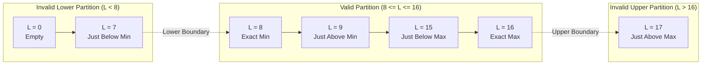
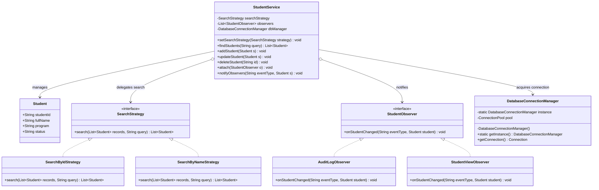

# BCL2113 Software Engineering: Continuous Assessment Case Study

Chan Jing Yi | SUOL2500321 | Bachelor of Information Technology (Honours)

## 1. Scenario 1: Software Testing through Boundary Value Analysis

### 1.1 Equivalence Partitioning and Boundary Testing Theory

Defects in input validation rarely appear at random across an input domain; instead, they cluster tightly around the numerical thresholds where conditional logic changes state (Myers, Sandler and Badgett, 2011). Boundary Value Analysis (BVA) targets this empirical pattern by selecting test inputs directly on, and immediately adjacent to, the edges of ordered equivalence partitions (ISTQB, 2024). When a login module requires a password between 8 and 16 characters inclusive, the character length $L$ divides the input space into three ordered partitions: an invalid lower partition ($L < 8$), a valid acceptance partition ($8 \le L \le 16$), and an invalid upper partition ($L > 16$).

*Figure 1. Equivalence partitions and boundary values for password length validation ($8 \le L \le 16$).*

Under the ISTQB Foundation Level framework, two principal variants of BVA govern test selection (ISTQB, 2024). Two value BVA exercises each boundary value together with its closest neighbour in the adjacent partition, yielding four essential points for a bounded integer range: 7, 8, 16, and 17. Three value BVA strengthens fault detection by also testing the immediate interior neighbours of each valid boundary, adding lengths 9 and 15 (Jorgensen, 2014). Relying solely on a mid range value such as 12 characters would confirm only that the acceptance path executes; it would completely miss an off by one relational defect where a developer writes `length > 8` instead of `length >= 8`, or `length < 16` instead of `length <= 16`.

### 1.2 Boundary Test Case Suite for the Login Module Password Field

To achieve complete two value and three value boundary coverage across both endpoints, six structured test cases are designed in Table 1. All cases assume a valid, registered username and printable ASCII characters so that length validation is isolated from unrelated authentication or encoding variables.

*Table 1. Boundary value test cases for the login module password field (8 to 16 characters).*

| Test ID | Boundary Classification | Sample Password Input | Length | Expected System Behaviour | Primary Defect Class Targeted |
| :--- | :--- | :--- | :---: | :--- | :--- |
| **TC01** | Invalid lower boundary (min minus 1) | `Pass123` | 7 | Reject input and display a validation message stating that the password must contain at least 8 characters. | Incorrect minimum threshold (e.g., `>= 7`) or missing lower bound check. |
| **TC02** | Valid lower boundary (exact min) | `Pass1234` | 8 | Accept password and proceed to credential verification. | Off by one strict inequality (`> 8` instead of `>= 8`) rejecting valid shortest passwords. |
| **TC03** | Valid interior lower neighbour (min plus 1) | `Pass12345` | 9 | Accept password and proceed to credential verification. | Misplaced boundary shift (e.g., enforcing `>= 9` or incorrect array offset). |
| **TC04** | Valid interior upper neighbour (max minus 1) | `SecurePass12345` | 15 | Accept password and proceed to credential verification. | Premature upper rejection (e.g., `< 15`) or buffer reservation error. |
| **TC05** | Valid upper boundary (exact max) | `SecurePass123456` | 16 | Accept password and proceed to credential verification. | Off by one strict inequality (`< 16` instead of `<= 16`) or null terminator truncation. |
| **TC06** | Invalid upper boundary (max plus 1) | `SecurePass1234567` | 17 | Reject input and display a validation message stating that the password must not exceed 16 characters. | Missing upper limit enforcement, silent truncation to 16 characters, or buffer overflow. |

### 1.3 Justification of Each Boundary Test Case

**TC01 (7 characters, just below minimum)** verifies that the authentication module enforces the lower security floor without exception. If a developer accidentally implements zero based index logic or sets the minimum threshold to seven, weak passwords slip past the client and server validators. Testing directly at seven characters provides the tightest possible negative check; a shorter string such as three characters would fail even under a broken `>= 6` rule and leave the defect hidden (Myers, Sandler and Badgett, 2011).

**TC02 (8 characters, exact minimum)** directly exposes the most frequent coding mistake in range validation: substituting a strict inequality (`length > 8`) for an inclusive one (`length >= 8`). When that defect occurs in production, legitimate users who choose an eight character password are locked out despite following the published policy. Confirming acceptance at exact length eight proves that the lower boundary belongs to the valid partition.

**TC03 (9 characters, just above minimum)** and **TC04 (15 characters, just below maximum)** complete three value BVA coverage around both endpoints (ISTQB, 2024). While two value BVA checks the transition across each boundary, three value BVA detects subtle misalignments where a developer reverses a condition or shifts a constant by one unit in the wrong direction. For instance, if an erroneous check reads `length == 8` during a hasty refactor, TC02 passes while TC03 immediately fails, exposing the broken logic.

**TC05 (16 characters, exact maximum)** guards against inclusive upper bound failures and storage truncation. In languages or database schemas that reserve a fixed 16 byte field alongside a null terminator or metadata byte, a 16 character input can trigger an unexpected rejection (`length < 16`) or silently drop the final character before hashing. Testing at exact length 16 confirms that maximum length credentials remain intact through both interface validation and backend processing.

**TC06 (17 characters, just above maximum)** ensures that oversized inputs are explicitly rejected rather than silently truncated. Silent truncation is a subtle security and usability hazard: a user enters a 17 character password, the system quietly strips the seventeenth character, and subsequent logins succeed with an unintended 16 character prefix. Explicit rejection at length 17 also verifies that the backend rejects tampered HTTP requests when an attacker bypasses client side HTML `maxlength` attributes.

### 1.4 Critical Evaluation of Boundary Testing Scope

Boundary Value Analysis delivers high fault detection efficiency per test case, yet it does not constitute a complete verification strategy for an authentication module (Sommerville, 2016). Length checks must be tested on both the client interface and the server endpoint because browser constraints are trivially bypassed. Engineers should also verify how length is measured when users enter multi byte Unicode characters or leading and trailing spaces, since counting UTF 8 bytes instead of code points can cause a 16 character password to fail a 16 byte check. From a security engineering perspective, enforcing a rigid 16 character ceiling warrants architectural scrutiny: contemporary standards such as the OWASP Application Security Verification Standard recommend allowing passwords of at least 64 characters without truncation while checking credentials against breached password lists (OWASP, 2025). Where legacy constraints mandate an 8 to 16 character limit, pairing BVA with null input testing ($L = 0$), character set validation, and injection testing establishes a defensible quality baseline.

---

## 2. Scenario 2: Applying Design Patterns in a Student Management System

### 2.1 Architectural Context and Core Requirements

A university Student Management System must sustain routine Create, Read, Update, and Delete (CRUD) operations, render detailed student profiles, and support flexible searching by student name or identifier. In a naive procedural or tightly coupled object oriented design, search conditionals grow tangled inside a monolithic manager class, user interface views fall out of sync whenever records change, and unmanaged database connections accumulate under concurrent administrative use. Design patterns provide proven structural templates that isolate these axes of change and elevate software maintainability (Gamma et al., 1994). Three complementary Gang of Four patterns, namely the **Strategy**, **Observer**, and **Singleton** patterns, address search extensibility, state synchronisation, and shared resource control respectively.

*Figure 2. Integrated class architecture applying Strategy, Observer, and Singleton patterns to the Student Management System.*

### 2.2 Pattern 1: Strategy Pattern (Behavioral)

**Purpose and Role.** The Strategy pattern defines a family of interchangeable algorithms, encapsulates each algorithm within its own class implementing a shared interface, and allows the client to select or swap algorithms dynamically at runtime (Gamma et al., 1994). Rather than hard coding multiple behavioural branches inside a single method, the context object delegates execution to whichever concrete strategy is currently injected.

**Application to the Student Management System.** The system must search student records by name or by student ID, and university requirements frequently expand to include programme code, intake cohort, or fuzzy partial name matching. Under the Strategy pattern, a `SearchStrategy` interface declares a single method `search(records, query)`. Two concrete classes, `SearchByIdStrategy` (performing exact or indexed hash lookup on `studentId`) and `SearchByNameStrategy` (performing case insensitive substring or token matching on `fullName`), encapsulate the distinct retrieval mechanics. `StudentService` holds a reference to `SearchStrategy` and delegates `findStudents(query)` without knowing which concrete algorithm runs.

**Impact on Robustness and Maintainability.** Isolating each search mechanism honours the Open/Closed Principle and Single Responsibility Principle (Martin, 2017). Adding a new `SearchByProgramStrategy` requires introducing a new class without editing or risking regressions inside existing ID or name search logic. Each strategy can be unit tested independently with focused edge cases, such as duplicate surnames or malformed student IDs, strengthening overall reliability.

### 2.3 Pattern 2: Observer Pattern (Behavioral)

**Purpose and Role.** The Observer pattern establishes a one to many dependency between a subject and multiple dependent observers so that whenever the subject alters its state, all registered observers are notified automatically (Gamma et al., 1994). The subject interacts with dependents strictly through an abstract observer interface, eliminating compile time coupling between the data producer and its consumers.

**Application to the Student Management System.** Every add, update, or delete operation on a student record triggers secondary obligations across a university platform: the administrative dashboard table must refresh, an immutable audit log must record who modified the record and when, and downstream modules such as academic advising or notification services may need to react to withdrawals or profile corrections. Here, `StudentService` acts as the concrete subject maintaining a registry of `StudentObserver` instances (`attach`, `detach`, and `notifyObservers`). When `updateStudent()` or `deleteStudent()` commits successfully, the subject broadcasts the event type and affected `Student` payload to concrete listeners including `StudentViewObserver` and `AuditLogObserver`.

**Impact on Robustness and Maintainability.** Decoupling record mutation from side effects prevents the core CRUD methods from becoming bloated with logging, email, and interface refresh calls. If university compliance later mandates a new `DataSyncObserver` for the campus library system, developers simply register the new listener without modifying tested persistence logic. Separating read views from mutation routines also reduces stale UI defects, ensuring staff always inspect accurate student details after edits.

### 2.4 Pattern 3: Singleton Pattern (Creational)

**Purpose and Role.** The Singleton pattern guarantees that a class has exactly one instance throughout the application lifecycle and provides a controlled, global access point to that instance (Gamma et al., 1994). It achieves this by making the class constructor private and exposing a static accessor that performs thread safe lazy or eager initialisation.

**Application to the Student Management System.** All CRUD operations, profile detail lookups, and search queries depend on shared infrastructure resources, primarily the database connection pool and system configuration settings. Implementing `DatabaseConnectionManager` as a thread safe Singleton ensures that `StudentService` and any reporting or authentication modules draw connections from one centrally managed pool rather than instantiating separate database handles per request.

**Impact on Robustness and Maintainability.** Uncontrolled connection creation quickly exhausts database socket limits during peak enrolment periods, causing cascading timeouts and partial writes. Centralising connection lifecycle management enforces uniform connection pooling, transaction timeouts, and credential loading from a single authoritative module. Maintenance improves because migrating database drivers or tuning pool capacity requires changing only `DatabaseConnectionManager` instead of auditing scattered instantiation sites across the codebase.

### 2.5 Critical Justification, Trade Offs, and Architectural Alternatives

Applying design patterns uncritically introduces unnecessary abstraction, so each choice must be weighed against its operational costs and realistic alternatives (Sommerville, 2016; Martin, 2017). Table 2 synthesises the architectural rationale, inherent trade offs, and viable alternatives for all three patterns in the Student Management System.

*Table 2. Comparative evaluation of selected design patterns, trade offs, and alternatives.*

| Pattern | Category | Role in Student Management System | Key Benefit | Primary Trade Off | Viable Alternative |
| :--- | :--- | :--- | :--- | :--- | :--- |
| **Strategy** | Behavioral | Interchangeable student search algorithms (by ID, by name, or future criteria). | Eliminates branching conditionals; simplifies unit testing and extension. | Increases class proliferation if only two trivial criteria ever exist. | First class functional predicates (lambdas) or Specification pattern for composite queries. |
| **Observer** | Behavioral | Notifying UI views, audit logs, and external modules on student CRUD changes. | Loosely coupled state synchronisation; protects core CRUD logic from bloat. | Risks lapsed listener memory leaks and opaque execution chains during debugging. | Asynchronous Event Bus or Publish/Subscribe broker (e.g., RabbitMQ) for distributed scale. |
| **Singleton** | Creational | Single managed `DatabaseConnectionManager` pooling database access. | Prevents connection exhaustion; centralises configuration and pooling policy. | Introduces hidden global state; complicates isolated unit testing and mocking. | Dependency Injection (DI) container managing a singleton scoped service instance. |

The combination of Strategy, Observer, and Singleton is justified because each pattern resolves a distinct structural pressure present in the university scenario without overlapping responsibilities. Strategy governs algorithmic variability in querying, Observer governs reactive propagation after state mutations, and Singleton governs scarce infrastructure resources. Together, they keep the core domain model small while accommodating predictable institutional growth.

Even so, engineering discipline requires recognising when alternatives outperform textbook implementations. For **Singleton**, a classic static `getInstance()` call tightly couples callers to a concrete class, making it awkward to substitute an in memory mock database during automated testing (Martin, 2017). In production frameworks such as Spring or ASP.NET Core, teams typically preserve the single instance guarantee while passing the manager through constructor **Dependency Injection**, gaining testability without losing resource control. Similarly, if the Student Management System evolves from a single desktop or web service into distributed university microservices, synchronous in process **Observer** callbacks can block transactions if a slow listener hangs; replacing them with an asynchronous **Event Bus** or message queue isolates failure domains. Should the system later differentiate student types with complex validation rules (such as Undergraduate, Postgraduate, and Exchange records), introducing a **Factory Method** pattern alongside the three selected patterns would cleanly encapsulate object construction without disturbing the search or notification architecture.

---

## References

Gamma, E., Helm, R., Johnson, R. and Vlissides, J. (1994) *Design Patterns: Elements of Reusable Object Oriented Software*. Reading, MA: Addison Wesley.

ISTQB (2024) *Certified Tester Foundation Level (CTFL) Syllabus Version 4.0*. International Software Testing Qualifications Board. Available at: https://istqb.org/certifications/certified-tester-foundation-level-ctfl-v4-0/ (Accessed: 25 November 2026).

Jorgensen, P.C. (2014) *Software Testing: A Craftsman's Approach*. 4th edn. Boca Raton, FL: CRC Press.

Martin, R.C. (2017) *Clean Architecture: A Craftsman's Guide to Software Structure and Design*. Boston, MA: Prentice Hall.

Myers, G.J., Sandler, C. and Badgett, T. (2011) *The Art of Software Testing*. 3rd edn. Hoboken, NJ: John Wiley & Sons.

OWASP (2025) *Application Security Verification Standard (ASVS)*. Open Worldwide Application Security Project. Available at: https://owasp.org/www-project-application-security-verification-standard (Accessed: 25 November 2026).

Sommerville, I. (2016) *Software Engineering*. 10th edn. Harlow: Pearson Education.
