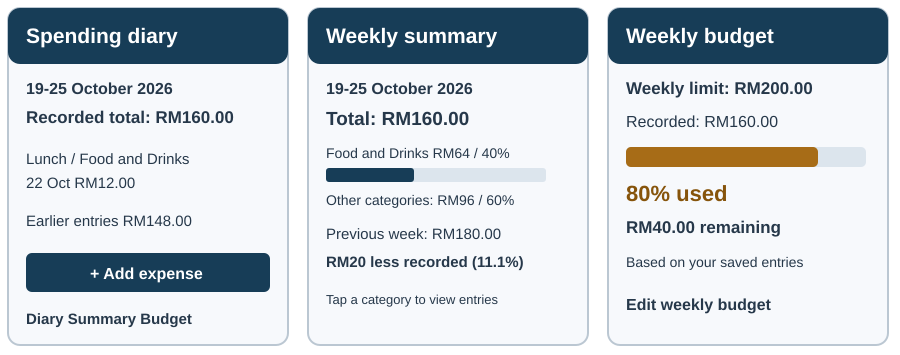

# Where Did My Money Go?

## An Android Spending Diary with Weekly Summaries and Budget Insights

**Assignment 1: Project Proposal (20%)**

**Course:** BCL2344 - Web and Mobile Development  
**Programme:** Bachelor of Computer Science (Honours) ODL  
**Faculty:** Faculty of Engineering, Built Environment, and Information Technology  
**University:** SEGi University

**Student Name:** Chan Jing Yi  
**Student ID:** SUOL2500321  
**Semester:** September, AY 2026  
**Date:** 22 October 2026

<!-- page -->

# 1. Project Information

## 1.1 Introduction of Proposed Application

Where Did My Money Go? is a proposed Android application that helps users understand their everyday spending through a simple diary, weekly summaries, budget warnings and friendly insights. It is intended for people who reach the end of a week knowing they have spent money but cannot easily explain where it went. Instead of requiring a detailed accounting process, the application will turn manually entered expenses into a clear account of the user's recorded spending.

A user will enter an amount, select a category and confirm the date, with an optional note such as “Lunch at campus”. The application will group these entries into categories such as Food and Drinks, Transport, Shopping, Bills and Other. Its weekly summary will display the total spent, a category breakdown and a comparison with the previous week. A user-defined weekly budget will provide context for these totals, while short insights will highlight patterns that can be traced back to the diary.

The application's informative purpose is to explain recorded behaviour in a form that is easier to interpret than a list of transactions. A message such as “Food and Drinks made up 40% of your recorded spending this week” will connect a calculation with the entries behind it. The application will not access bank accounts, move money or claim that its totals represent every purchase the user has made. Its value will depend on the completeness and accuracy of manual entries.

## 1.2 Problem Statement and User Needs

Everyday purchases may be spread across cash, cards and electronic wallets. Reviewing one payment history may therefore give only a partial view of spending, while remembering small purchases at the end of the week can be difficult. A spreadsheet can combine entries, but a user must maintain its structure and interpret the results. This proposal treats that effort as a design problem to investigate; it does not claim that a survey has established how many people experience it.

The target users are university students and young adults who want a lightweight way to review personal expenses. They need a short entry process, meaningful categories and summaries that explain where their recorded money went. A budget indicator should tell them how much of their chosen allowance has been used without suggesting that the application knows their bank balance. Friendly language should encourage review without judging individual purchases.

<!-- page -->

## 1.3 Project Aims

The first aim is to make everyday expense recording straightforward. A record will contain an amount in Malaysian ringgit (MYR), a category, a date and an optional note. The expected outcome is that a user can save a valid expense from the main screen through one entry form. Records will remain editable so that mistakes do not permanently distort later summaries.

The second aim is to translate individual entries into useful weekly information. The application will calculate a total, category amounts and category shares for a selected Monday-to-Sunday week. It will also show the difference from the preceding calendar week. A fixed demonstration dataset will be checked by hand to confirm that the displayed totals and comparisons are correct. These are planned acceptance criteria, not results already achieved.

The third aim is to make a personal weekly spending limit visible. The user will be able to set a positive budget, view the amount remaining and receive an in-app warning when recorded spending reaches 80% of the limit or reaches or exceeds the limit. The application will update these indicators after an expense is added, edited or deleted. A missing budget will produce a prompt to set one rather than a misleading warning.

The fourth aim is to present understandable, engaging insights and retain data between sessions. Rule-based messages will identify patterns such as the largest spending category or the most frequently recorded category. Each message will state its period and refer to recorded entries. The diary, budget and summaries should remain available after the application is closed and reopened without an internet connection.

# 2. Proposed Application

## 2.1 Target Platform

The first release will target Android phones using Flutter and Dart. Flutter supports application development for several platforms, but this project will focus on Android to keep implementation and evaluation manageable (Flutter, n.d.-b). The planned difficulty is easy to medium: the core work involves forms, navigation, local database operations and transparent arithmetic rather than bank integration or predictive modelling.

SQLite, accessed through the `sqflite` package, will store expense records and the weekly budget. Flutter documents this approach for creating, retrieving, updating and deleting local structured data (Flutter, n.d.-c). Amounts will be stored as whole-number sen and formatted as MYR for display. The first release will support one person on one device, with no registration, cloud synchronisation or payment processing.

<!-- page -->

## 2.2 Application Features

### Quick Expense Entry and Spending Diary

The Add Expense form will accept an amount, category, date and optional note. The amount must be greater than zero and contain no more than two decimal places; the category must be selected and the date must not be in the future. Successful saving will return the user to the diary with a visible confirmation. The diary will group entries by date, show daily totals and allow filtering by category or week. Selecting an entry will open its details for editing or deletion, with confirmation before deletion.

### Weekly Summary and Category Breakdown

The weekly summary will show the selected date range, total recorded spending and a labelled bar chart of category amounts. Text values will accompany the chart so that information is not available only through colour or bar length. Users will be able to open a category to inspect the entries contributing to its total. Empty weeks will display a clear no-records message rather than imply that the user definitely spent nothing.

### Weekly Budget and In-App Warnings

Users will set one weekly spending limit that applies to the displayed weeks. The screen will explain that changing it recalculates the indicators for all weeks; historical budget versions are outside the first release. A progress bar will show recorded spending against the limit. For a budget of RM200, spending of RM160 will trigger an “80% used” warning; RM210 will display “RM10 over budget”. Warnings will appear inside the application when records or screens are refreshed. Background notifications are outside the core scope.

### Friendly Spending Insights

Short, rule-based cards will make the summary more approachable. An illustrative message could read, “Your most frequent category was Food and Drinks: 8 entries this week.” A second card might show the largest category share or a decrease from the previous week. Messages will use neutral, encouraging language, with no shame-based labels or claims about the user's personality. They will be calculated from saved records, without an AI service, and will link to the relevant diary view.

### Week-to-Week Comparison

A comparison panel will display the absolute change in recorded spending between the selected week and the preceding week. A percentage change will appear only when the previous total is greater than zero. If the preceding week has no entries, the panel will state that there is no recorded baseline. The application will explain that entering fewer purchases can affect the comparison; a lower total does not necessarily mean the user changed their behaviour.

<!-- page -->

## 2.3 Interaction Design and Practical Scope

The interface will have three main destinations: Diary, Weekly Summary and Budget. A prominent Add Expense action will be available from the diary. The typical interaction will begin with recording a purchase, continue with checking its effect on the weekly total, and end with reviewing a category or budget message. Summary cards will provide routes back to the underlying entries so users can understand why a figure appears.

*Figure 1. Proposed diary, weekly summary and budget screens. All amounts and entries are illustrative. These are interface concepts, not screenshots of a completed application.*

For example, a student could record lunch costing RM12 under Food and Drinks. If the selected week previously contained RM148 of expenses, the total would become RM160. With a weekly budget of RM200, the Budget screen would then show RM40 remaining and an 80% warning. If the student corrects lunch to RM10, the total would become RM158 and the warning would clear. This example provides a concrete demonstration of how diary changes affect the rest of the application.

The visual design will use readable amounts, clear category labels and short explanations beside totals. Status text will accompany budget colours, while chart values will remain available as text. Text scaling, descriptive control labels and screen-reader navigation will be reviewed with Flutter's accessibility guidance in mind (Flutter, n.d.-a). Insights will remain optional to read; the main totals and entry controls will be easy to locate.

Dates will represent local calendar dates, and weeks will run from Monday through Sunday. Transfers, refunds, income tracking, multiple currencies, receipt recognition and shared household accounts are outside the first release. Local storage avoids a project-operated account service, but it does not constitute a backup: clearing app data or losing the device may remove records. The application will not request banking credentials or claim to provide a complete financial record.

<!-- page -->

## 2.4 Development and Evaluation

Development will begin with the three main screens and a small illustrative dataset. The next stage will connect the expense form and diary to SQLite, including edit and delete operations. Weekly calculations and budget states will follow, before adding insight cards and completing interface review. This order allows each summary to be checked against working diary records rather than building visual reports around disconnected sample values.

Evaluation will cover valid and invalid entries, saving and reopening records, category filtering and recalculation after edits or deletion. Calculation checks will include expenses on a Monday and Sunday, a week with no entries, a zero-valued comparison baseline, spending exactly at 80% and spending exactly at the budget limit. A labelled demonstration will show both the expected arithmetic and the resulting screens. No claim of improved saving behaviour will be made without evidence from later evaluation.

## 2.5 Monetization and Future Development

A possible future business model is a free core spending diary with optional premium analytics. The free version would retain expense entry, weekly summaries, budget warnings and the basic insight cards described in this proposal. A premium tier could later offer longer-term trend comparisons, custom reporting periods and exportable reports. This would let users evaluate the everyday utility before deciding whether deeper analysis is useful to them.

Premium analytics is a commercial direction rather than an implemented assessment requirement. Subscription billing, purchases and access restrictions will not be part of the first release. There is no verified demand or pricing study at this stage, so the proposal does not assume a subscription price, customer uptake or revenue. These questions would require user research after the core prototype has been evaluated.

<!-- page -->

# 3. Project Summary

## 3.1 Conclusion

Where Did My Money Go? proposes an Android spending diary that connects quick expense entry with weekly explanations. Its core functions will let a user record and correct purchases, review category totals, compare recorded weeks and check a personal budget. Friendly insights will make the figures approachable while preserving access to the entries behind them. Flutter and local SQLite storage provide the proposed technical foundation for a single-device prototype.

## 3.2 Project Value

The application's main value is the transition from individual purchases to an understandable weekly picture. A user will be able to answer which category accounted for the most recorded spending, how that spending compares with the preceding week and how much of a chosen budget remains. These answers will be presented together rather than requiring the user to calculate them manually.

Its practical scope supports an achievable individual project while offering a future route to premium analytics. The expected benefit is greater awareness of recorded spending, not guaranteed savings. Manual entry remains its main limitation; clear labels, simple forms and traceable calculations will help users understand what the information can reasonably tell them.

# References

Flutter. (n.d.-a). *Accessibility*. Retrieved October 22, 2026, from https://docs.flutter.dev/ui/accessibility

Flutter. (n.d.-b). *FAQ*. Retrieved October 22, 2026, from https://docs.flutter.dev/resources/faq

Flutter. (n.d.-c). *Persist data with SQLite*. Retrieved October 22, 2026, from https://docs.flutter.dev/cookbook/persistence/sqlite
