# Smart Campus Companion

## Mobile Application Wireframe Design

**Task 2: Assessment 1 (20%)**

**Course:** BCL2344 - Web and Mobile Development  
**Programme:** Bachelor of Computer Science (Honours) ODL  
**Faculty:** Faculty of Engineering, Built Environment, and Information Technology  
**University:** SEGi University

**Student Name:** Chan Jing Yi  
**Student ID:** SUOL2500321  
**Semester:** September, AY 2026  
**Date:** 27 November 2026

<!-- page -->

# 1. Project Information

## 1.1 Application Concept

Smart Campus Companion brings a student’s timetable, campus directions, services, events and notices into one mobile interface. The home screen shows the next activity and its location. Related screens carry the user directly from a class to its location, from a facility to its reservation form, and from an event listing to its ticket.

## 1.2 Intended Users

The primary users are university students who need to find rooms and use campus services between classes. New students can look up unfamiliar buildings or request a step free route, while returning students can check their schedule, reserve a study room or act on an announcement. The names, locations, schedules, prices and references shown are illustrative.

## 1.3 Key Design Decisions

The dashboard, map, services and events share a bottom navigation bar. The dashboard keeps the next class above the campus shortcuts; the profile and alert inbox sit in its header. Detail screens use a back control and a clearly named primary action. A student can see the selected slot or the full ticket total before committing.

Time, location and status occupy consistent positions inside cards. Selected controls use both fill and type weight, while unread notices, reservations and payment outcomes have explicit status text (World Wide Web Consortium [W3C], n.d.). The mobile layout uses one column. On wider screens, the timetable and map could place supporting details beside the primary content while retaining the same reading and navigation order.

## Reference

World Wide Web Consortium. (n.d.). *Understanding SC 1.4.1: Use of Color*. Web Accessibility Initiative. [https://www.w3.org/WAI/WCAG22/Understanding/use-of-color.html](https://www.w3.org/WAI/WCAG22/Understanding/use-of-color.html)

<!-- page -->

# 2. User Interaction Flow

## 2.1 Sign In and Dashboard

The numbers in the diagrams match the wireframe labels. Arrows show what opens after a tap.

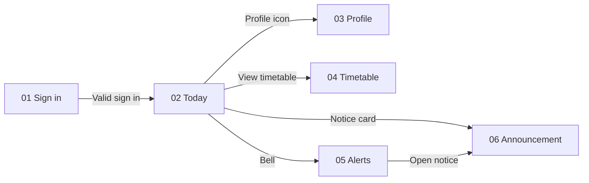

## 2.2 Campus Map, Services and Events

The bottom bar switches between **02 Today**, **07 Campus map**, **09 Facilities and services** and **13 Campus events**. The dashboard also offers shortcuts to the map and service directory.

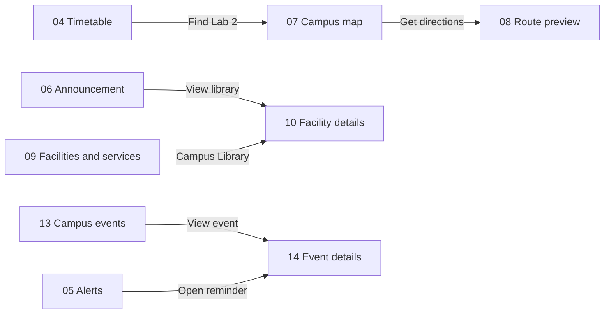

The back control preserves the prior screen’s filter or selection. Sign out takes the user from **03 Profile** to **01 Sign in**. Opening the map from the timetable selects Lab 2. Opening it from the library’s details selects the library.

<!-- page -->

# 2. User Interaction Flow (Continued)

## 2.3 Study Room Reservation

A student selects a date and time before confirming. A reservation appears only after the service confirms that the slot is available.

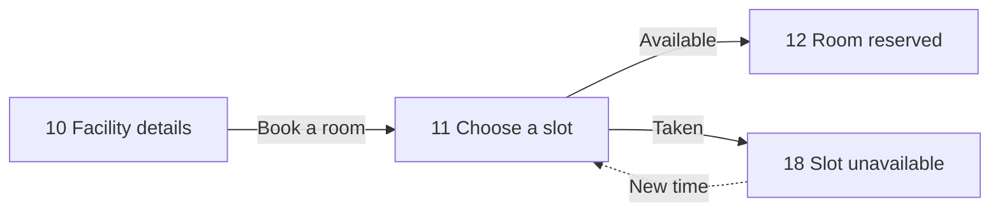

After confirmation, **Get directions** opens **08 Route preview** and **Done** returns to **09 Facilities and services**.

## 2.4 Event Ticket Payment

Paid events require a separate review and payment decision. The ticket is issued when the service confirms payment.

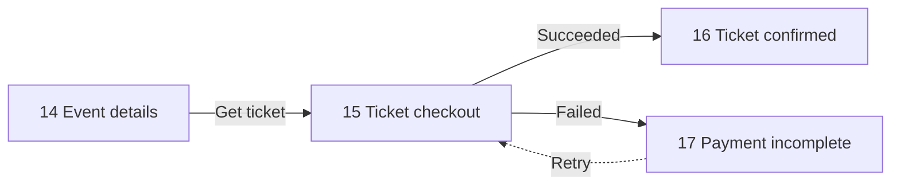

Dashed arrows indicate recovery paths. Cancelling checkout or leaving the failure screen returns to **14 Event details**. **Back to events** on the confirmed ticket opens **13 Campus events**. A pending payment disables retries until the bank confirms the outcome.

<!-- page -->

# 3. Wireframe Design

## 3.1 Sign In and Profile

### 01 Sign in
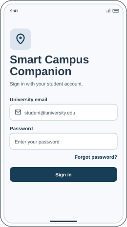

Students enter a university email and password. Valid credentials open Today. A failed attempt shows an inline message and preserves the email. Forgot password opens the university’s recovery service.

### 03 Profile
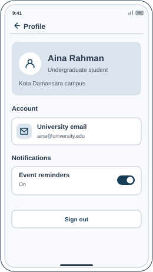

Students review their campus account and switch event reminders on or off. The text beside the switch reflects the setting. Sign out returns to Sign in.

<!-- page -->

# 3. Wireframe Design (Continued)

## 3.2 Dashboard and Timetable

### 02 Today
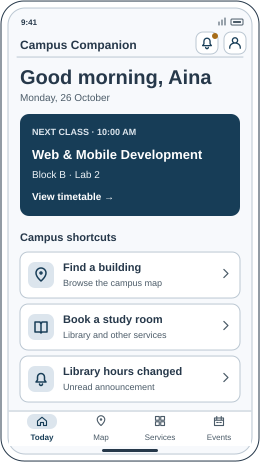

The next class leads to Timetable. Shortcuts open the map, services or the featured announcement. The header opens Profile and Alerts, and the bottom bar switches between main sections.

### 04 Timetable
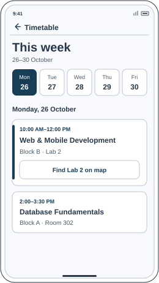

Selecting a weekday replaces the day’s class list. Find Lab 2 on map opens Campus map with the class location selected.

<!-- page -->

# 3. Wireframe Design (Continued)

## 3.3 Alerts and Announcements

### 05 Alerts
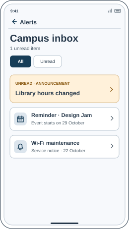

All and Unread filter the inbox. Opening the library notice marks it as read and updates the unread count. Selecting the Design Jam reminder opens Event details.

### 06 Announcement
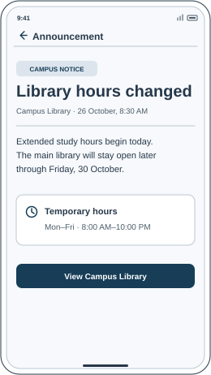

This screen gives the source, publication time and temporary opening hours. View Campus Library opens its facility details.

<!-- page -->

# 3. Wireframe Design (Continued)

## 3.4 Campus Navigation

### 07 Campus map
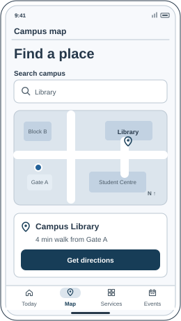

Search by facility or room, or select a map pin. The result card gives the destination and walking estimate. Get directions opens the route preview.

### 08 Route preview
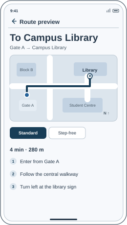

Standard and Step-free switch route options and update the distance, walking estimate and written directions. The numbered directions can be followed independently of the map.

<!-- page -->

# 3. Wireframe Design (Continued)

## 3.5 Facilities and Services

### 09 Facilities and services
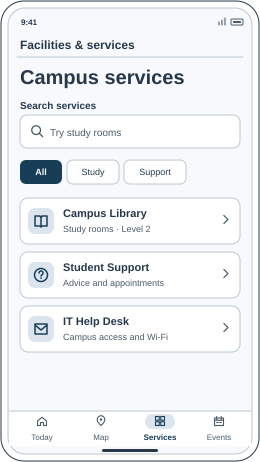

Search matches campus services. Category filters narrow the list. Selecting Campus Library opens its hours, room availability and directions.

### 10 Facility details
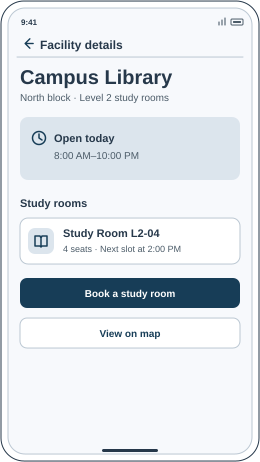

Students check opening hours and room capacity before reserving. Book a study room opens slot selection. View on map opens the map centred on the library.

<!-- page -->

# 3. Wireframe Design (Continued)

## 3.6 Study Room Reservation

### 11 Choose a slot
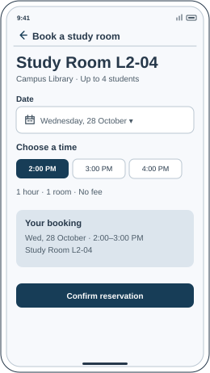

Changing the date refreshes the time options. Selecting a slot updates the summary. Confirm reservation checks availability and proceeds to confirmation or the slot unavailable state.

### 12 Room reserved
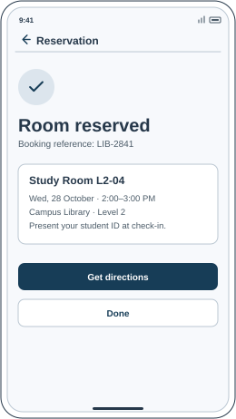

The confirmation provides a reference, location, time and check in instructions. Get directions opens Route preview for the library. Done returns to Services.

<!-- page -->

# 3. Wireframe Design (Continued)

## 3.7 Campus Events

### 13 Campus events
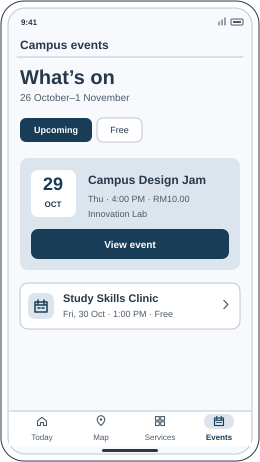

Students browse upcoming events or filter for free options. Date, price and venue support a quick comparison. View event opens the selected listing.

### 14 Event details
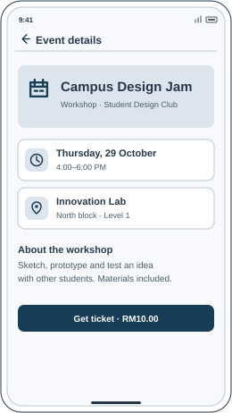

The event page explains who is organising the workshop, when it takes place and what the ticket includes. Get ticket opens checkout for the displayed price.

<!-- page -->

# 3. Wireframe Design (Continued)

## 3.8 Ticket Checkout and Confirmation

### 15 Ticket checkout
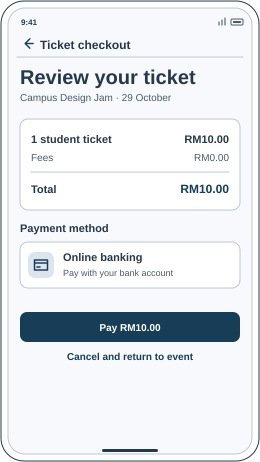

The student reviews the item, fees and total before proceeding to their bank. Cancelling returns to Event details. The bank’s response determines the payment outcome.

### 16 Ticket confirmed
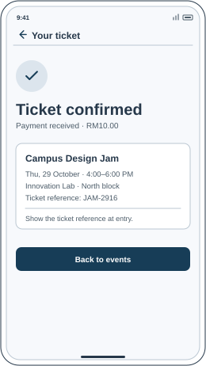

A confirmed payment generates a ticket reference with the venue and time. The student can show the reference at entry or return to the events list.

<!-- page -->

# 3. Wireframe Design (Continued)

## 3.9 Transaction Recovery

### 17 Payment incomplete
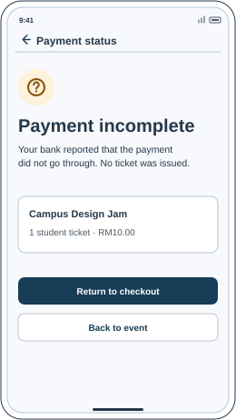

A confirmed payment failure explains that no ticket was issued. The student can return to checkout with the same ticket or return to Event details.

### 18 Slot unavailable
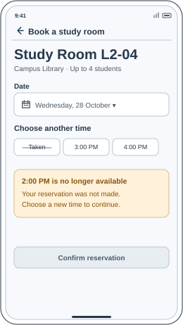

The date stays selected if another student takes the chosen slot. Confirm reservation stays disabled until a new time is selected. The revised choice returns to the booking summary.
