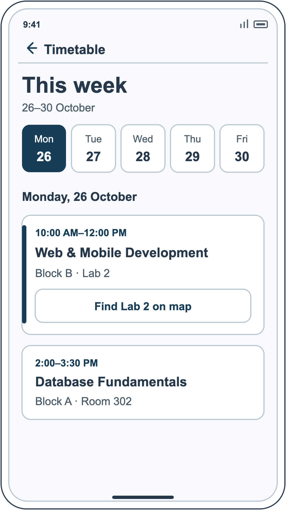
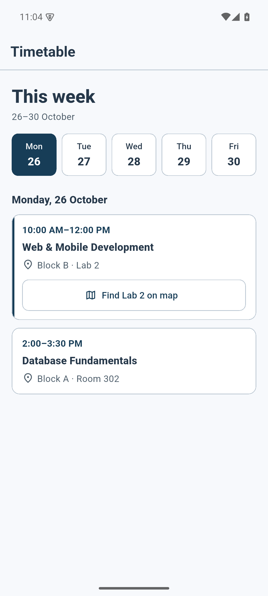
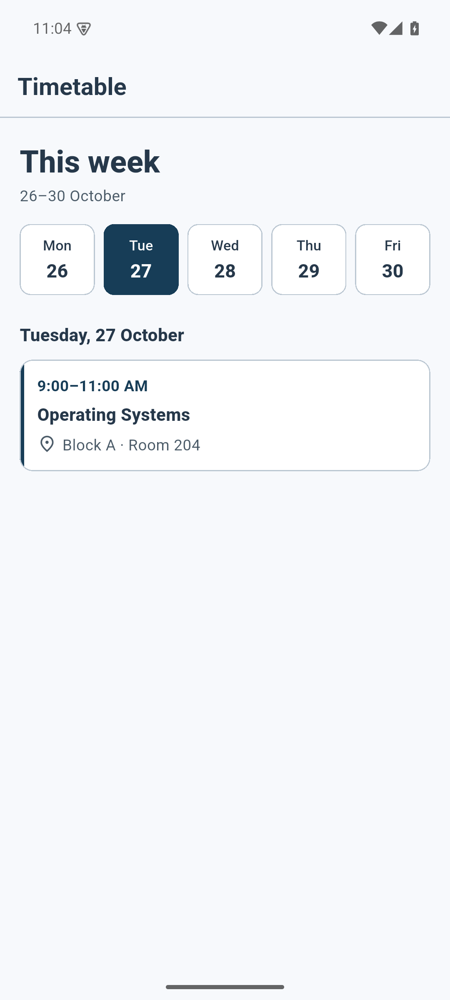
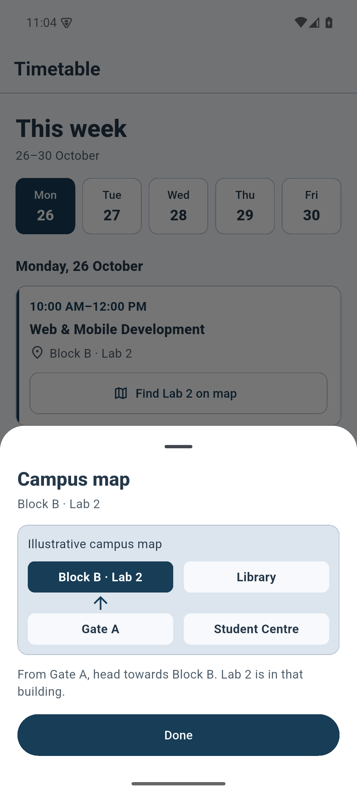

# Smart Campus Companion

## Timetable Screen in Flutter

**Lab Assessment 2**
BCL2344 · Web and Mobile Development
Chan Jing Yi · SUOL2500321
SEGi University · September 2026 semester

## Screen and wireframe

The Timetable screen lets students see when and where classes take place. It follows Frame 04 from Lab Assessment 1, retaining the week heading, five weekday controls and class cards ordered by time. The stand-alone screen opens on Monday, 26 October 2026, using the sample week from the wireframe.

<figure><figcaption><strong>Figure 1.</strong> Lab Assessment 1, Frame 04.</figcaption></figure>
<figure><figcaption><strong>Figure 2.</strong> Monday timetable on the Android emulator.</figcaption></figure>

<!-- page -->

## Widgets and responsive layout

A `Scaffold` and `AppBar` establish the screen. A vertically scrolling `ListView` within a `SafeArea` holds the heading, weekday controls and class cards. Each `Card` uses a `Column` to keep the time, module and room in a consistent order. A location `Icon` makes the room line easier to find.

A `LayoutBuilder` sizes the five `OutlinedButton` weekday controls using the available width. On narrow screens or with large text, the weekday row can scroll horizontally. Class titles and room text can wrap, and a `ConstrainedBox` keeps the timetable readable on wider displays.

## Interactive features

**Select a weekday.** Tapping a date updates the selected state, date heading and class list. Tuesday shows Operating Systems. Friday shows “No classes scheduled for this day.” The selected control has a navy fill and a selected state exposed to assistive technology.

**Find Lab 2.** Tapping **Find Lab 2 on map** opens a bottom sheet that highlights Block B and shows its position relative to Gate A. The timetable stays underneath and retains the selected day when the sheet closes. Class times and map locations are illustrative.

<figure><figcaption><strong>Figure 3.</strong> Class list after selecting Tuesday.</figcaption></figure>
<figure><figcaption><strong>Figure 4.</strong> Lab 2 location in the map sheet.</figcaption></figure>

